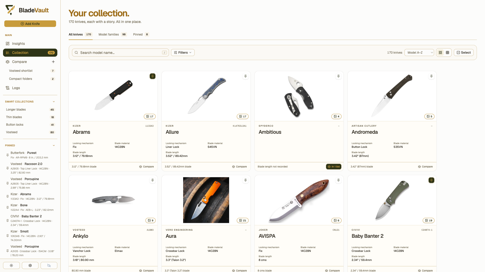

# BladeVault documentation

**A sharp, local-first knife collection manager.** Catalog your knives, compare them side by side, and keep your collection data under your own control.

## Start here

| I want to | Go to |
| --- | --- |
| Get running in a few minutes | [Quickstart](quickstart.md) |
| Run it as a container | [Docker and Podman](installation/docker.md) |
| Run it on Kubernetes | [Kubernetes with Helm](installation/helm.md) |
| Use the desktop app | [Desktop app](installation/desktop.md) |
| Build and run from source | [Run from source](installation/from-source.md) |
| Learn the collection, comparison and insights workflows | [Guides](guides/collection.md) |
| Connect an AI client to my collection | [MCP](reference/mcp.md) |
| Find my data, back it up, or lock the app | [Your data](reference/data.md) |

## What it does

- **Catalog** — keep specifications, pricing, provenance, notes, links, and local photos for every knife. Import product details from supported retailer URLs, with an interactive browser fallback.
- **Organize** — search, filter, pin, and bulk-edit records; add custom text, number, and date fields, and choose what appears on collection cards and in the pinned sidebar.
- **Browse** — save filters as Smart Collections that update with your records, or browse variants together in Model families. Global search understands model names and `/model A4301` for model numbers.
- **Compare** — create named shortlists, add a knife to several lists, show only the differences, and print or export comparisons as PDF.
- **Maintain** — log cleaning, lubrication, sharpening, stropping, and disassembly with dated notes, and review the history in Logs.
- **Understand** — explore makers, materials, dimensions, completeness, and activity through collection insights.
- **Keep control** — the vault lives in a local SQLite database, ZIP backups are portable, and cloud backup is optional.

## Choose a setup

| Option | Best for | Start here |
| --- | --- | --- |
| Desktop app | A native macOS or Windows experience | [Desktop app](installation/desktop.md) |
| Docker or Podman | A self-hosted local instance | [Docker and Podman](installation/docker.md) |
| Kubernetes | k3s or another Kubernetes cluster | [Kubernetes with Helm](installation/helm.md) |
| Source | Development and customization | [Run from source](installation/from-source.md) |

## Requirements

- **Node.js 24 LTS** only if you run from source; the repository pins `24.21.0` in `.nvmrc`.
- A container runtime (Docker or Podman), or a Kubernetes cluster with a `LoadBalancer` implementation such as MetalLB for the Helm path.
- **Chromium** if you want URL import and webpage capture from a source checkout (`npx playwright install chromium`).

## Links

- [Download the latest release](https://github.com/dedkola/bladevault/releases/latest) · [full release history](https://github.com/dedkola/bladevault/releases) · [demo video](https://youtu.be/yurbpv0JY80)
- [Source code](https://github.com/dedkola/bladevault) · [contributing guide](https://github.com/dedkola/bladevault/blob/main/CONTRIBUTING.md) · [code of conduct](https://github.com/dedkola/bladevault/blob/main/CODE_OF_CONDUCT.md)
- BladeVault is released under the [MIT License](https://github.com/dedkola/bladevault/blob/main/LICENSE).
