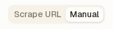
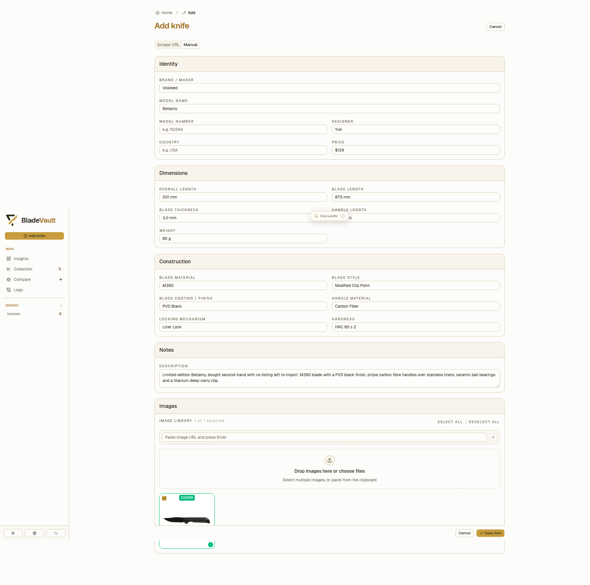
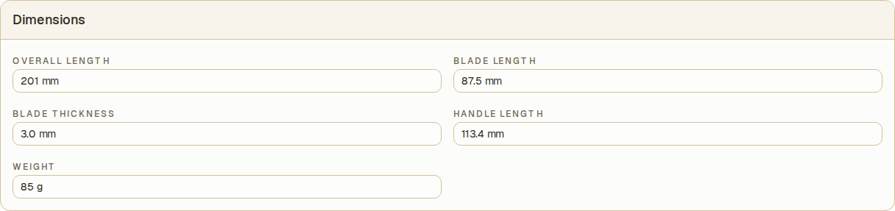
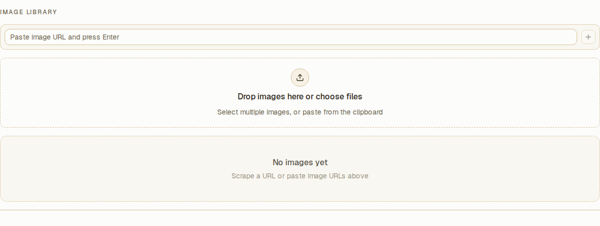
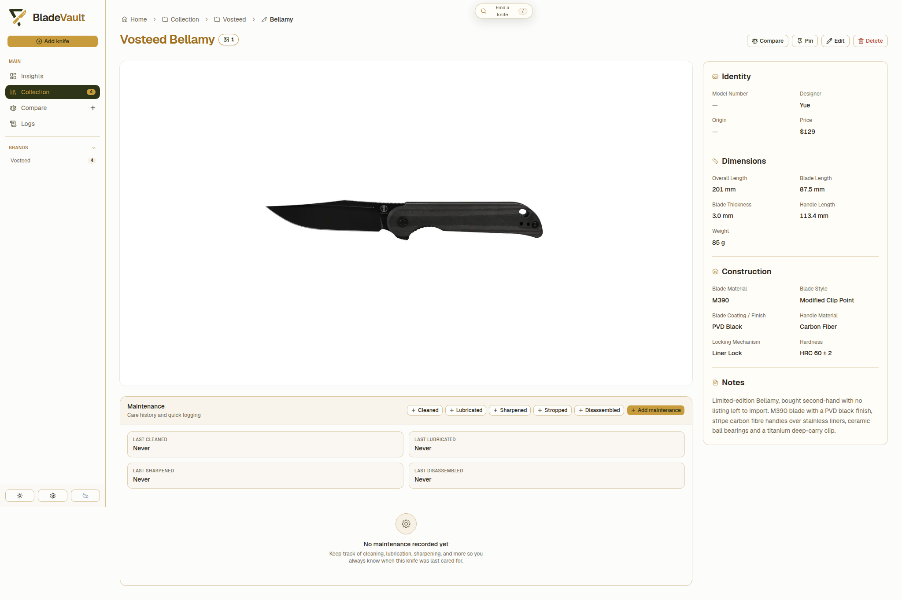

# Add knife in manual mode

Some knives have no page to import: a piece bought second-hand, a gift, a custom build, a model whose listing is long gone. The **Manual** tab is the other half of **Add knife** — you fill in every field yourself, no URL needed. The record below is a limited-edition Vosteed Bellamy (M390, carbon fibre) entered this way.

## 1. Switch to the Manual tab

Click **Add knife** at the top of the sidebar, then click the **Manual** tab:

The URL field is replaced by the full form:

The fields are grouped the way you think about a knife: **Identity** (brand/maker, model name, model number, designer, country, price), **Dimensions** (overall, blade, thickness, handle length, weight), **Construction** (blade material, style, coating, handle material, locking mechanism, hardness), **Notes**, and **Images**.

## 2. Fill in what you know

Every dimension takes the value as the maker states it, unit included:

Nothing is required except a name — leave a field blank rather than guess, and the record shows **Not recorded** for it later. The Bellamy above has no model number and no stated country of origin, so both stay empty.

## 3. Give it pictures

Under **Images**, paste an image URL into the field and press Enter or click the **+** button; dropping files onto the dashed area works too:

Anything you add is downloaded into your vault, so it travels with the record and is included in ZIP backups and [cloud backups](../reference/cloud-backup.md) — no link to a shop that might take the picture away.

## 4. Save knife to collection

At the bottom right of the form, click **Save Item**:

**Save Item** writes the record and takes you to the collection. From there the knife behaves exactly like an imported one: it can be edited, compared, pinned, given maintenance history, and found through search or a Smart Collection.

## 5. See the saved knife

## Which route to use

- **Import it** when the product page exists and describes the knife — see [Add Knife to collection](add-knife-to-collection.md).
- **Type it in** when it does not, or when you only want the fields you care about. A partial record beats no record.

## Next

- [Add several knives at once](add-several-knives.md) — batch scrape a list of links.
- [Organize your collection](collection.md) — custom fields, cards, and Smart Collections.
