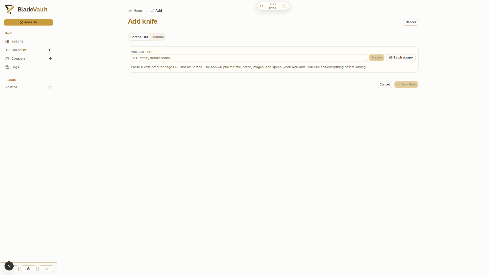
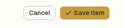
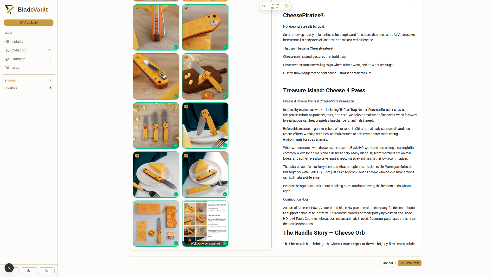

# Add a knife from a product URL

Import a product page to fill in a knife's specifications and images. Paste the URL, review the imported details, and save the record. The screenshots below show a real import of a Vosteed CheesePirates (A2932) from `vosteed.com`.

## 1. Click **Add knife**

Click **Add knife** at the top of the sidebar:

The form opens on the **Scrape URL** tab. To enter a knife without a product page, use **Manual**. See [Add a knife manually](add-knife-in-manual-mode.md).

## 2. Paste the product URL and click **Scrape**

Paste the retailer's product URL into **Product URL** and click **Scrape**, or press Enter. BladeVault opens the page in a browser and reads its title, brand, images, and specifications.

## 3. Check what the import filled in

Review the imported identity, price, dimensions, construction details, and description. A field can remain empty if the page does not provide a clear value. This example lists two handle lengths for different variants, so the import leaves that field blank and explains why. Every field stays editable. Use **Scraped page preview** beside the form to check a value against its source.

## 4. Choose the images to keep

Product images are stored in the vault when you save the record and are included in ZIP backups and [cloud backups](../reference/cloud-backup.md). Deselect images you do not want, choose a **cover**, and reorder or remove images as needed. You can also add your own photos or image URLs.

## 5. Save the knife to your collection

At the bottom right of the form, click **Save Item**:

**Save Item** saves the record and returns you to Collection.

## 6. See the saved knife

Click the new knife's card in **Collection**, then choose **Open full page →** in its preview to review the saved details:

The record contains the saved specifications, images, source link, and notes. You can edit these details later.

The knife also appears as a card in Collection.

## Add several links at once

**Batch scrape** imports a list of product URLs one at a time. Products already saved from the same source URL are skipped. See [Add several knives at once](add-several-knives.md) for the full walkthrough.

## Add a knife manually

Use **Manual** for a gift, a custom build, or an older knife without a product page. You can enter specifications, price, notes, a source link, and local photos. See [Add a knife manually](add-knife-in-manual-mode.md).

## When a retailer blocks the import

Some sites block automated access or display popups over the product details. BladeVault removes recognizable newsletter and cookie overlays before capturing the page. Use **Hide popups** in the preview to hide remaining dialogs, or **Restore original** to return to the imported preview. These actions preserve your form edits.

If the page needs a click or a verification step, choose **Interact with page** beside the URL. Complete the step in the browser window, then click **Continue** to refresh the import in the same form. Your manually edited fields and image selections are preserved. The browser window opens on the computer running BladeVault. A browser inside a remote container is not streamed to your screen.

## Capture the source page

BladeVault can also save a permanent full-page screenshot of the page a record came from — the knife imported above has one. See [Capture source pages](capture-sources.md).

## Requirements

- **From source:** install Chromium (`npx playwright install chromium`) so URL import and capture can run.
- **Docker, desktop, Kubernetes:** the shipped image and desktop build already include the browser runtime.

## Next

- [Update a saved knife](update-a-saved-knife.md) — correct and extend what an import wrote.
- [Organize your collection](collection.md) — custom fields, cards, and Smart Collections.
- [Capture source pages](capture-sources.md) — keep the page you imported from.
