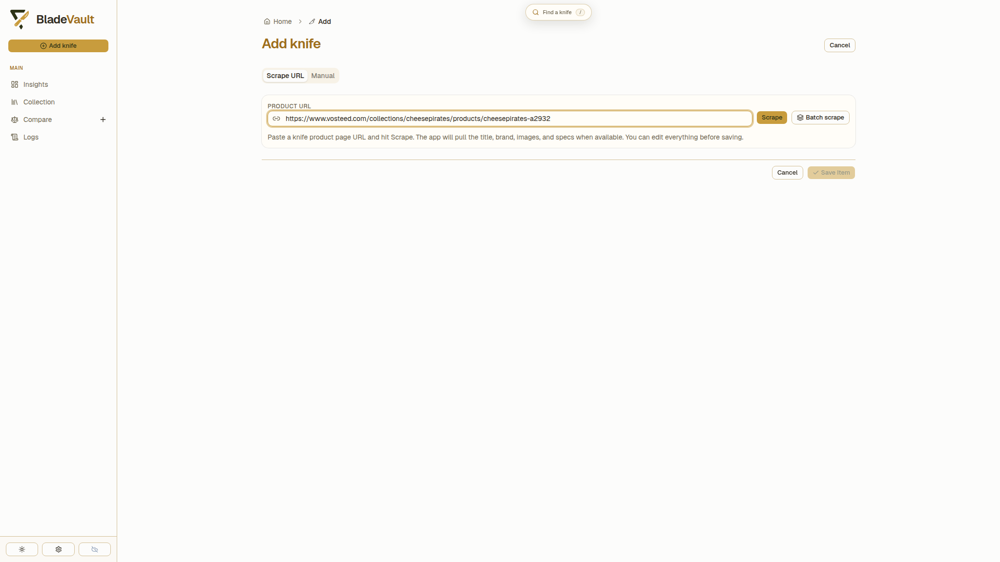
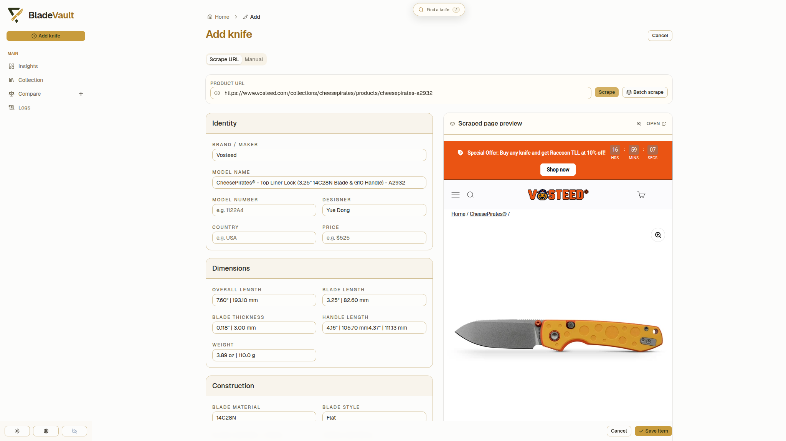
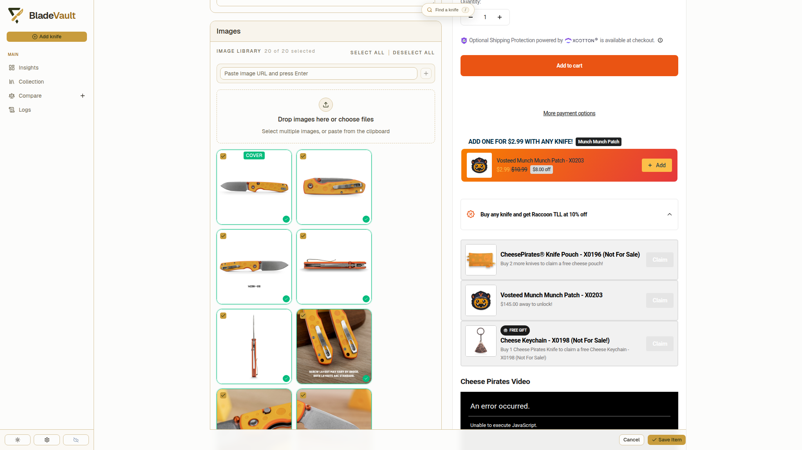
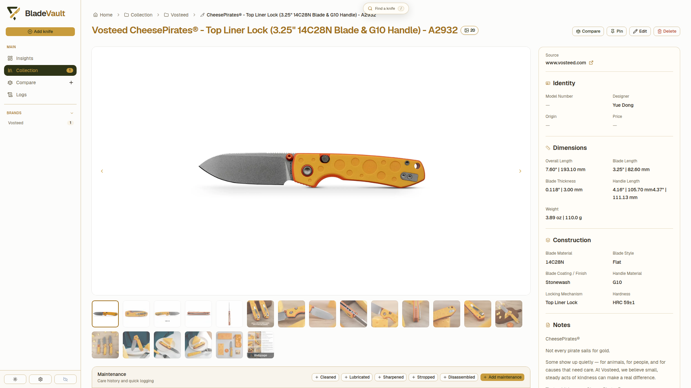
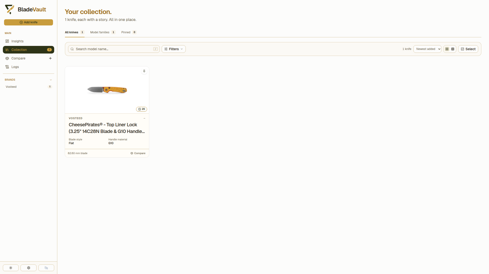

# Add Knife to collection

BladeVault can fill a record for you instead of you typing a dozen specifications by hand: paste a product URL, review what came back, save. Every screenshot below is from a real import — a Vosteed CheesePirates (A2932) from `vosteed.com`.

## 1. Open Add

Use **Add knife** in the sidebar. The page has two tabs — **Scrape URL** and **Manual**.

## 2. Paste the product URL and scrape

Paste the retailer's product page into **Product URL** and press **Scrape** (or Enter). BladeVault reads the page in a real browser, pulls the title, brand, images, and specifications, and downloads the product photos into your vault.

## 3. Review the imported values

The form comes back filled: brand/maker, model name, designer, dimensions (overall, blade, handle, weight), construction (blade material, style, coating, handle material, locking mechanism, hardness), and the description. Every field stays editable, and **Scraped page preview** shows the source page next to the form so a value can be checked against the page it came from.

## 4. Check the images

Product images are downloaded into the vault with the record, so they travel with your data and are included in ZIP backups and [cloud backups](../reference/cloud-backup.md). Deselect the ones you do not want, set a **cover**, reorder or remove them — or add your own photos and image URLs.

## 5. Save

**Save Item** writes the record and takes you to the collection, where the new knife appears as a card.

## Add several links at once

**Batch scrape** takes a pasted list of product URLs and adds them one after another — sequentially, not in parallel, so a retailer never sees a burst of requests from you. Products you already saved from the same source URL are skipped.

## Add a knife manually

The **Manual** tab gives you every field by hand, which is the right path for a knife with no product page — a gift, a custom build, an older piece with no online listing. Along with the built-in specifications you can store pricing, provenance, notes, links, and local photos.

## When a retailer blocks the import

Some sites block automated access. The import reports it and offers **Try interactive browser**: a real browser window opens, you complete the retailer's verification, then click **Continue** and the page is scraped into the same form.

## Capture the source page

BladeVault can also save a permanent full-page screenshot of the page a record came from — the knife imported above has one. See [Capture source pages](capture-sources.md).

## Requirements

- **From source:** install Chromium (`npx playwright install chromium`) so URL import and capture can run.
- **Docker, desktop, Kubernetes:** the shipped image and desktop build already include the browser runtime.

## Next

- [Organize your collection](collection.md) — custom fields, cards, and Smart Collections.
- [Capture source pages](capture-sources.md) — keep the page you imported from.
