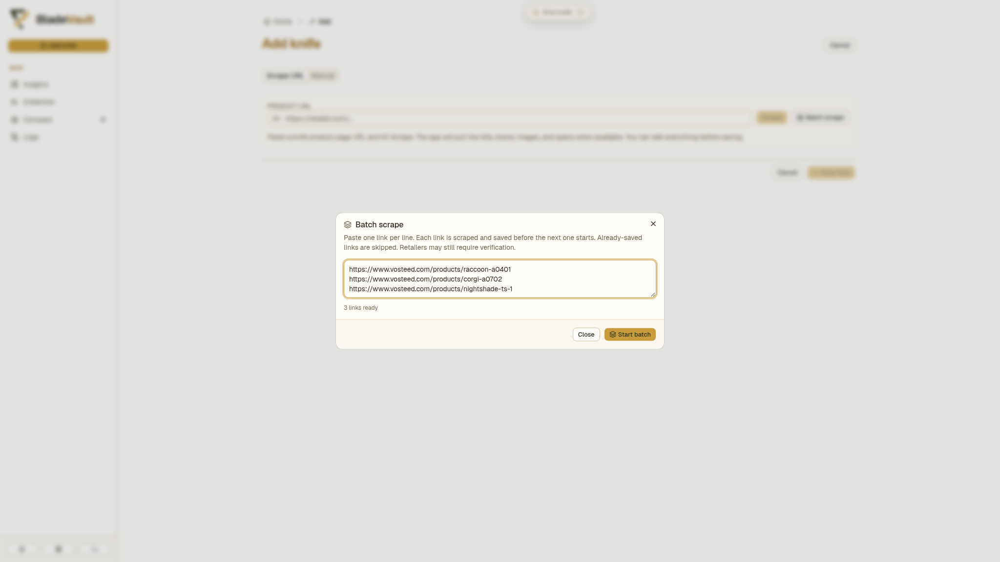
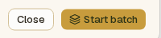
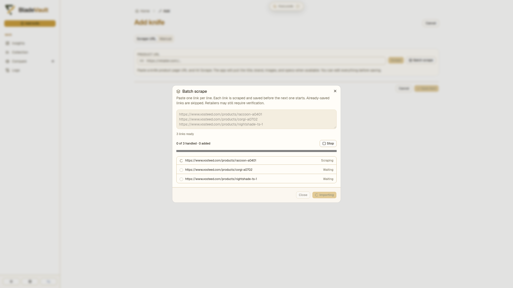
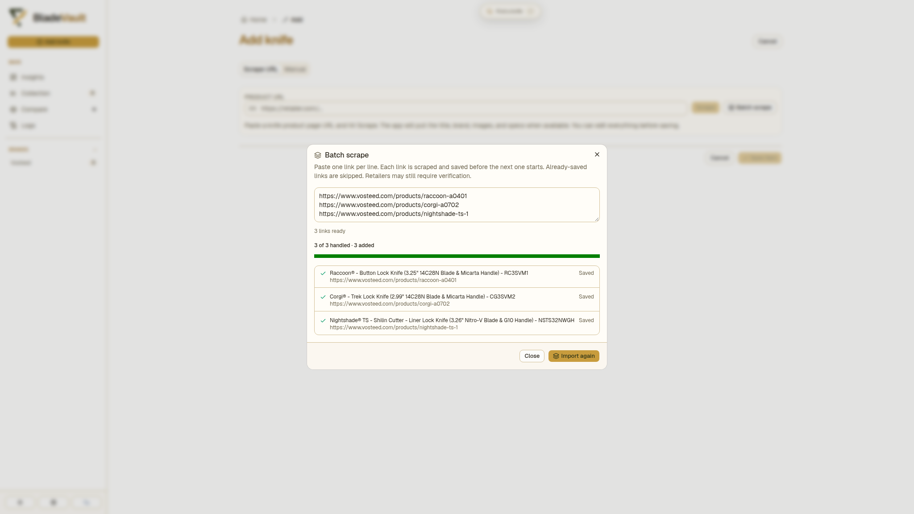
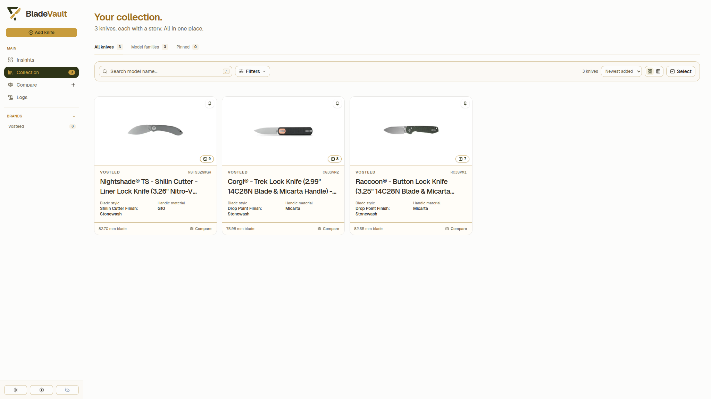

# Add several knives at once

Pasting links one at a time gets old when a batch arrives at once — a haul, a set of variants, a maker's whole line. **Batch scrape** takes a list of product URLs and works through it for you: each link is scraped, saved, and only then does the next one start. The three knives below are real imports from `vosteed.com` — a Raccoon (RC3SVM1), a Corgi (CG3SVM2), and a Nightshade TS (NSTS32NWGH).

## 1. Paste the links

Click **Add knife** at the top of the sidebar, then click **Batch scrape** next to the URL field. One link per line, in the order you want them added.

The line under the box counts what the dialog found. Links you have already imported are **skipped** rather than duplicated, and anything that is not a URL is ignored — both are reported before you start.

## 2. Start the batch

At the bottom of the dialog, click **Start batch**:

Only one link is in flight at a time, so a retailer never sees a burst of requests from you.

## 3. Watch the batch run

Each row shows its own state — **Waiting**, **Scraping**, **Saving**, **Saved**, **Skipped**, or **Failed** — and the progress bar tracks how far along the list is. **Stop** finishes the link that is running and leaves the rest alone.

## 4. Check the result

When the run ends the dialog reports how many links were handled and how many knives were added. A failed link does not stop the batch: fix the URL or the page, then run just that one.

## 5. See the knives in the collection

Batch imports are ordinary records — same specifications, same images, same source links, all editable. Nothing about them is second-class.

## Requirements

Batch scrape uses the same browser engine as a single import, so it needs Chromium:

- **From source:** `npx playwright install chromium`.
- **Docker, desktop, Kubernetes:** the shipped image and desktop build already include it.

## Next

- [Add Knife to collection](add-knife-to-collection.md) — the single-URL walkthrough, including the interactive fallback.
- [Add knife in manual mode](add-a-knife-by-hand.md) — for the knives no page describes.
