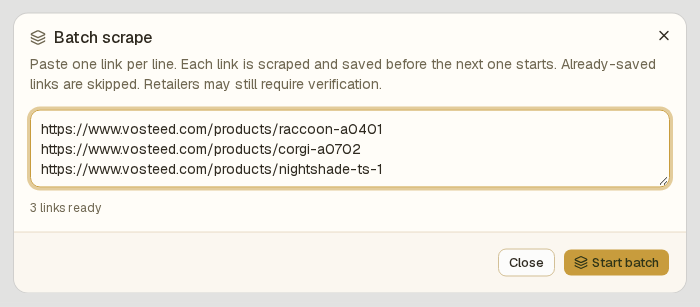

# Add several knives at once

Use **Batch scrape** to import several product URLs in one run. Each link is scraped and saved before the next one starts. The example below imports three knives from `vosteed.com`: a Raccoon (RC3SVM1), a Corgi (CG3SVM2), and a Nightshade TS (NSTS32NWGH).

## 1. Paste the links

Click **Add knife** at the top of the sidebar, then click **Batch scrape** next to the URL field. Paste one link per line in the order you want to import them.

The line below the input shows how many links are ready. URLs already saved in the collection are **skipped**, and entries that are not URLs are ignored. Review these counts before starting.

## 2. Start the batch

At the bottom of the dialog, click **Start batch**:

BladeVault processes one product URL at a time.

## 3. Watch the batch run

Each row shows its status: **Waiting**, **Scraping**, **Saving**, **Saved**, **Skipped**, or **Failed**. The progress bar shows how much of the list has been handled. **Stop** finishes the current link and leaves later links waiting. Use **Resume batch** to continue with the waiting links; it does not retry failed links.

## 4. Check the result

When the run ends, the dialog reports how many links were handled and how many knives were added. A failed link does not stop the batch. The panel below the list shows failed URLs. Use **Retry failed** to retry only those links, or **Copy failed links** to keep the list for later.

## 5. See the knives in the collection

Each imported knife has its own editable record, including specifications, images, and a source link.

## Requirements

Batch scrape uses the same browser engine as a single import, so it needs Chromium:

- **From source:** `npx playwright install chromium`.
- **Docker, desktop, Kubernetes:** the shipped image and desktop build already include it.

## Next

- [Add a knife from a product URL](add-knife-to-collection.md) — import a single page or use the interactive fallback.
- [Add a knife manually](add-knife-in-manual-mode.md) — enter a knife without a product page.
