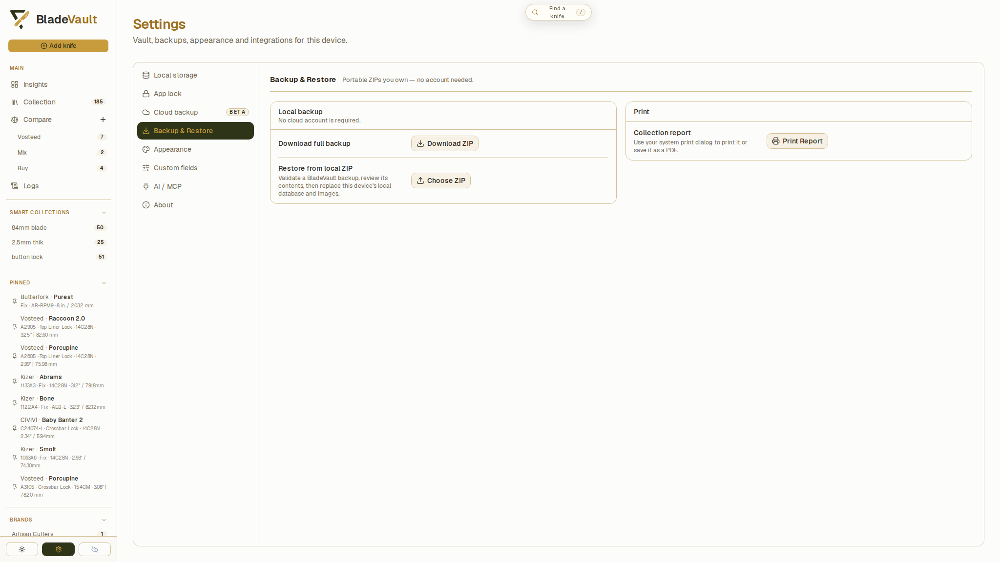
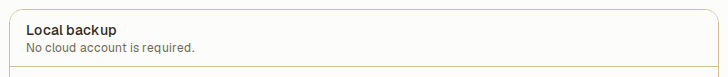
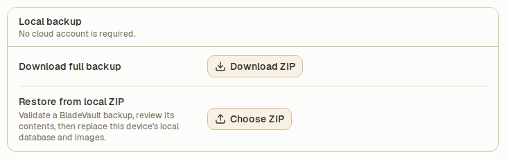
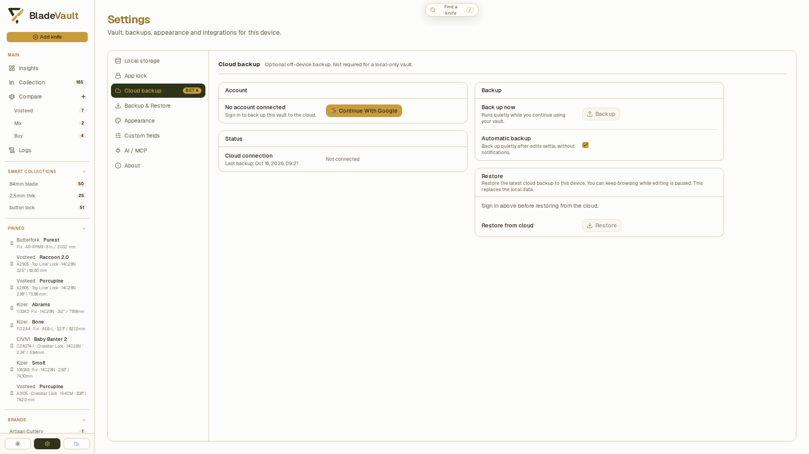
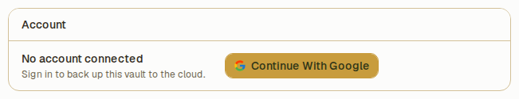
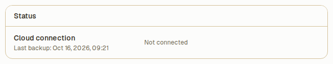
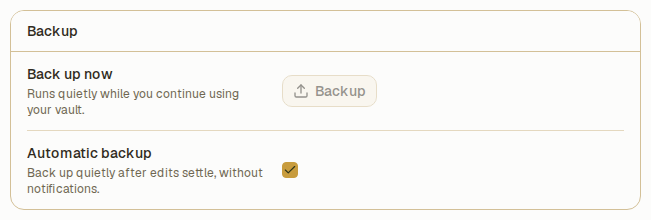
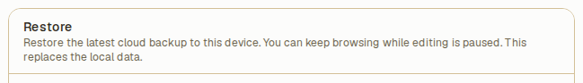

# Back up and restore your vault

A full-vault backup keeps your knife records, settings, Smart Collections, saved comparisons, maintenance and change history, and local images together. Use a local ZIP without an account, or sign in for an optional cloud copy.

Restoring a backup replaces the current vault. It does not merge two collections. Download a ZIP of the current vault first if you want to keep a separate copy before restoring another one.

## Download a local ZIP

1. Open **Settings → Backup & Restore**.

   

2. Under **Local backup**, click **Download ZIP**.

   

3. Save the archive when prompted, or find it in your browser's download folder. The suggested name includes the backup date, such as `bladevault-backup-2026-10-18.zip`.
4. Wait for the success message and check that the ZIP was saved where you expect.

Keep the archive intact for restoration. A printed or PDF collection report is useful for reading, but it is not a restorable vault backup.

## Restore a local ZIP

1. Open **Settings → Backup & Restore** on the device or server whose vault you want to replace.
2. Under **Restore from local ZIP**, click **Choose ZIP** and select a BladeVault backup archive.

   

3. Wait while BladeVault validates it. If validation fails, read the message and select a valid, compatible backup.
4. Review the confirmation: it shows the backup's creation time and the number of knives and images. Cancel if this is not the backup you intended to restore.
5. Confirm the replacement and wait for the success message. BladeVault keeps a safety copy of the current data before installing the restored vault.
6. Open **Collection**, check the expected records, and open a knife to confirm that its images and details are available.

BladeVault validates the archive before asking you to confirm, then checks and extracts it again during restoration. An ordinary ZIP of loose files is not a substitute for a BladeVault backup archive. A backup created with an incompatible newer database schema must be restored with a compatible BladeVault version.

If the restored vault has [App lock](../reference/data.md#optional-app-lock) enabled, unlock it with the password stored in that backup.

## Connect cloud backup

1. Open **Settings → Cloud backup**.

   

2. Click **Continue With Google**.

   

3. Complete sign-in in the popup. If the browser blocks the popup, allow it and try again.
4. Check that your account appears and **Cloud connection** shows **Connected**.

   

Signing in makes cloud backup available. Your working vault remains stored locally.

## Create a cloud backup

1. In **Settings → Cloud backup**, find **Back up now** and click **Backup**.

   

2. Keep the desktop app or self-hosted server running while the backup is prepared and uploaded. You can switch pages or reload the browser during the upload.
3. Return to the panel to check the status and updated **Last backup** time. Successful backups finish quietly, without a popup.

To back up after edits, enable **Automatic backup** in the same panel. During an open app session, BladeVault waits at least 30 seconds after edits settle before starting a backup. Changes made during a backup can be included in a later one.

Saved comparisons are included in full-vault backups, but changing a comparison list alone does not trigger an automatic cloud backup. Use **Backup** when you want to include those changes immediately.

## Restore the latest cloud backup

1. Open **Settings → Cloud backup** and sign in to the account containing the backup.
2. Under **Restore from cloud**, click **Restore**.

   

3. Confirm that you want to replace the local vault with the latest cloud backup.
4. Keep the desktop app or server running and check the restore status. You can browse the current collection during the download and validation, while editing and automatic backups are paused.
5. Wait for restoration to finish. BladeVault keeps a safety copy, installs the restored vault, and refreshes open views and images.
6. Check the expected collection and open a saved knife. If App lock is enabled in the backup, unlock with its password.

Cloud restore continues if you switch pages or reload the browser. Access pauses briefly while BladeVault applies the restored data. See [Cloud backup](../reference/cloud-backup.md) for background operation and recovery details.

## Move a vault to another device

Download a local ZIP on the original device, transfer it to the destination, and restore it there. The destination vault is replaced by the backup. You can also restore the latest cloud backup after signing in on the destination.

To change the data folder on the same desktop installation instead, see [Change the desktop data folder](../reference/data.md#change-the-desktop-data-folder). For filesystem copies and container storage, see [Your data](../reference/data.md).

## Related

- [Your data](../reference/data.md) — default folders, local storage controls, App lock, and filesystem backups.
- [Cloud backup](../reference/cloud-backup.md) — background jobs, safety copies, and service configuration.
- [Docker and Podman](../installation/docker.md) — keep container data in a persistent host folder.
