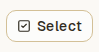
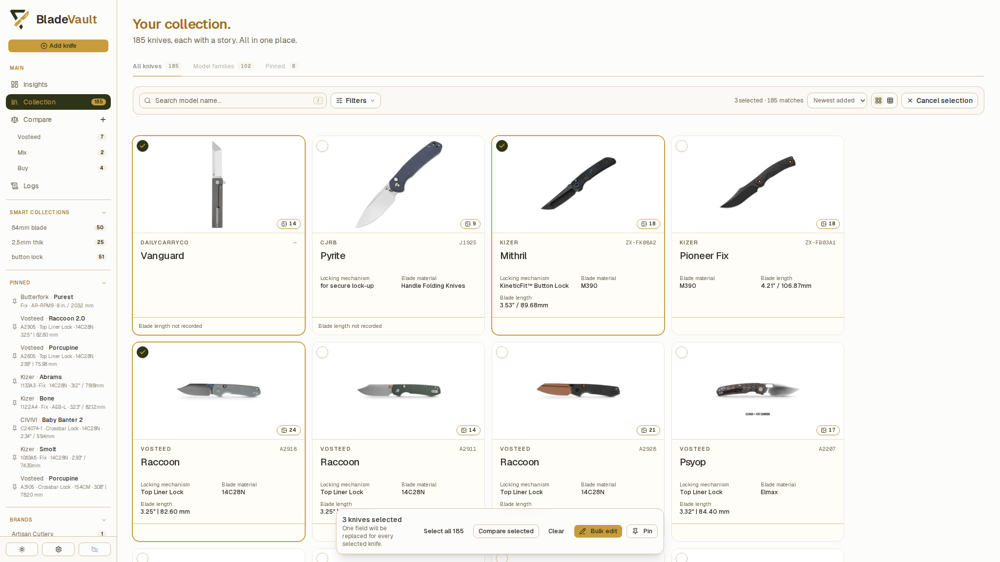
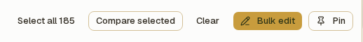
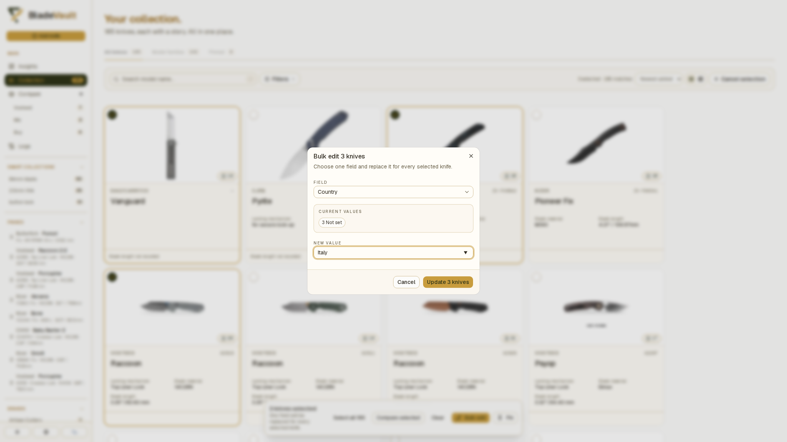
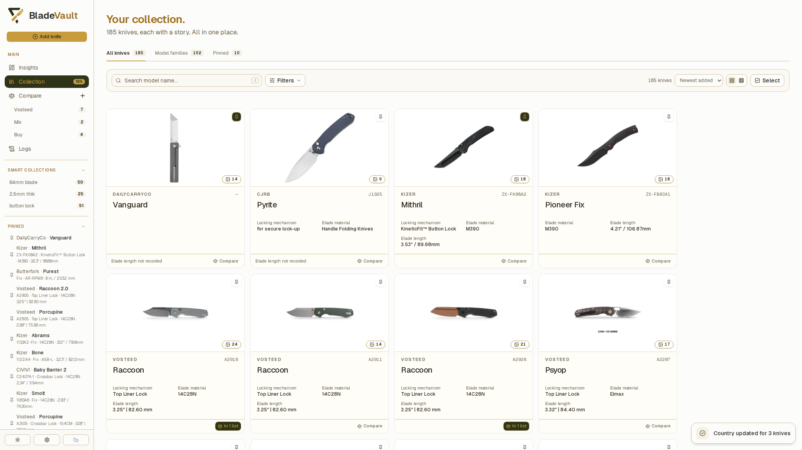
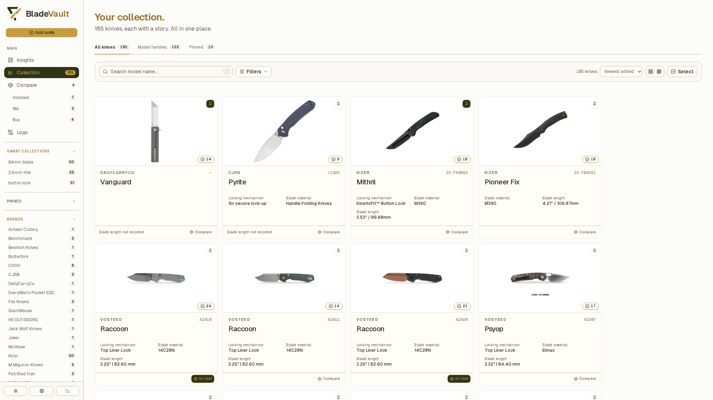
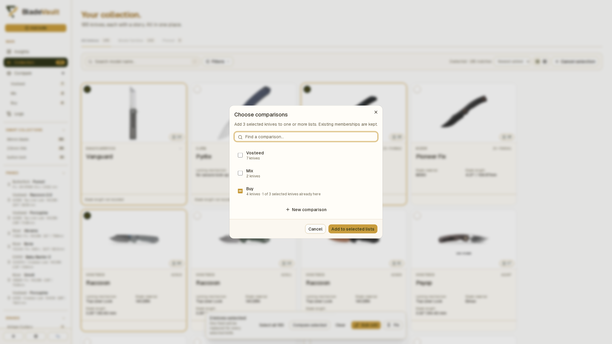

# Edit and pin several knives at once

Use the collection's selection controls to replace one field across several records, pin or unpin knives, or add a selection to comparisons.

Open **Collection** from the sidebar. Before making a large edit, you can [back up your vault](back-up-and-restore-your-vault.md).

## Select the records

1. Choose **All knives**, then use search and **Filters** to narrow the collection if needed.
2. Click **Select** above the cards.
3. Click individual cards to select them, or click **Select all** followed by the matching count in the bottom toolbar.
   
4. Check the selected count before continuing. Click a selected card again to remove it, or use **Clear** to empty the selection.

**Select all** selects every matching record, including cards you have not scrolled to yet. **Deselect matches** removes the current matches from the selection. If you change filters while selecting, previously selected records can remain selected even when they are no longer visible; use **Clear** before starting a different group.

Selection mode shows individual knives. If you enter it from **Model families** or **Pinned**, it switches to **All knives**, retaining the search and field filters. Review the matches before selecting all.

## Replace a field

1. With the intended knives selected, click **Bulk edit** in the bottom toolbar.
2. Choose a **Field**. Supported built-in fields and your custom fields appear in the list.
3. Check **Current values**. Each value is shown with the number of selected records that use it; empty values appear as **Not set**.
4. Enter the replacement in **New value**. Text fields may suggest values already used in your collection.
   
5. Click **Update** followed by the selected count.

The field is replaced with the same value for every selected record. After a successful update, selection mode closes and a confirmation appears.

Each bulk edit changes one field. A replacement must contain a value, so this dialog cannot clear a field. It also does not edit model names, model numbers, notes, images, or Sold status; open an individual record's **Edit** form for those changes.

## Pin or unpin the selection

1. Select the knives you want to change.
2. Click **Pin** in the bottom toolbar. If every selected knife is already pinned, the button reads **Unpin** instead.
3. Check the confirmation, then click **Cancel selection** when finished.

A mixed selection uses **Pin**, which leaves all selected knives pinned. To unpin a group, select only pinned knives so the action reads **Unpin**. Pinning keeps the selection available for another action.

Pinned records appear under **Pinned** in the sidebar and on the collection's **Pinned** tab. The optional **Keep pinned knives first** setting also puts them first in Insights, Collection, and Compare views.

## Add the selection to comparisons

1. Select the knives you want to compare.
2. Click **Compare selected** in the bottom toolbar.
3. If **Choose comparisons** opens, select the intended lists and click **Add to selected lists**. With one list, the knives are added directly. With no lists, enter a name in **New comparison** and click **Create & add**.
   
4. Open **Compare** to review them together.

See [Compare knives](compare.md) for saved lists, differences, and export options.

## Related guides

- [Search, filter, and sort your collection](search-and-filter.md) — find the intended records before selecting them.
- [Add and manage custom fields](custom-fields.md) — define extra fields that bulk editing can use.
- [Update a saved knife](update-a-saved-knife.md) — edit a complete individual record.
- [Review collection activity in Logs](review-collection-activity.md) — inspect recorded changes.
