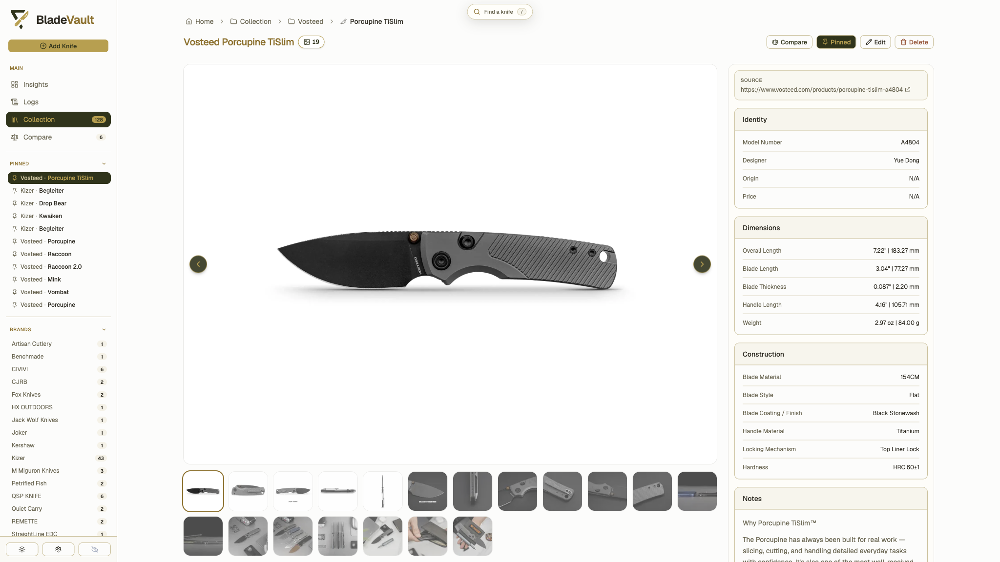

# Organize your collection

## Records

Each knife records specifications, pricing, provenance, notes, links, and local photos. Alongside the built-in fields you can add **custom text, number, and date fields** — useful for anything the defaults do not cover, such as a sharpening angle preference or a purchase channel.

## Cards and the pinned sidebar

You choose which details appear on collection cards and in the pinned sidebar, so the first glance shows what matters to you rather than every field at once.

## Finding things

- **Search and filter** across the collection, then narrow further with filters.
- **Global search** understands model names and `/model A4301` for model numbers.
- **Pin** the knives you keep coming back to.
- **Bulk edit** several records at once.

## Smart Collections

Save a filter as a **Smart Collection** and it stays live: the collection updates as your records change, so "folding knives with no notes" or "steels sharpened this year" stays true without maintenance.

## Model families

Variants of the same model are easier to reason about together. **Model families** browse them as a group, so you can compare a base model with its limited editions without hunting through the list.

## Maintenance history

Log cleaning, lubrication, sharpening, stropping, and disassembly with dated notes and sharpening details. Maintenance history and collection changes appear in **Logs**, so the record of what you did and when is kept with the knife.

## Next

- [Compare knives](compare.md) — build shortlists and export comparisons.
- [Collection insights](insights.md) — makers, materials, dimensions, completeness.
