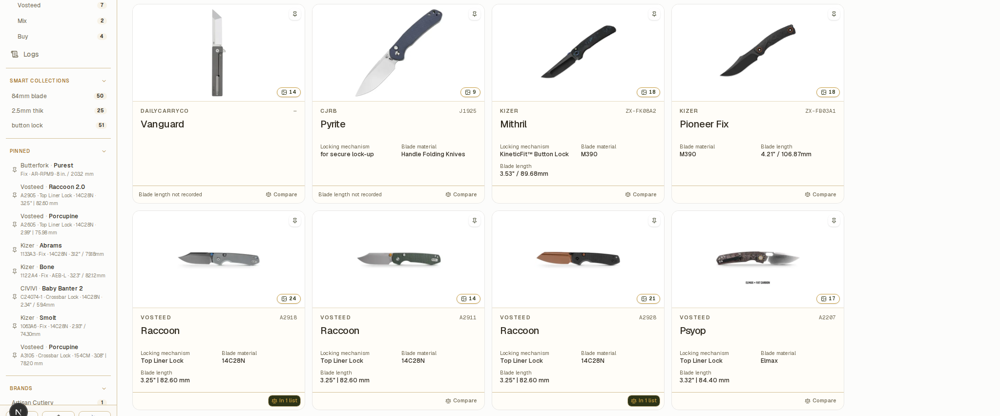
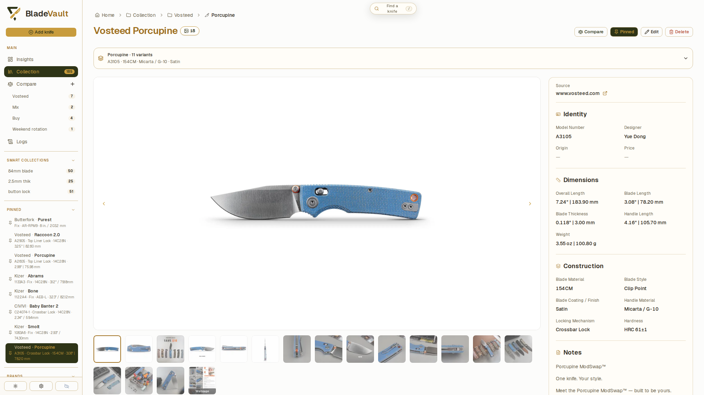
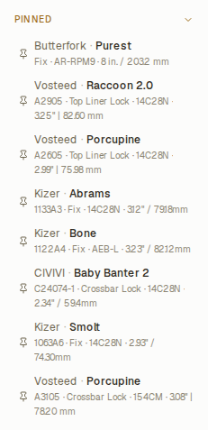
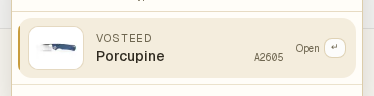
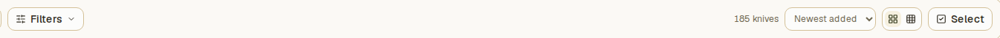
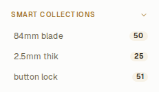
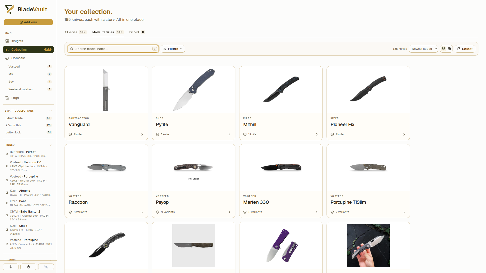
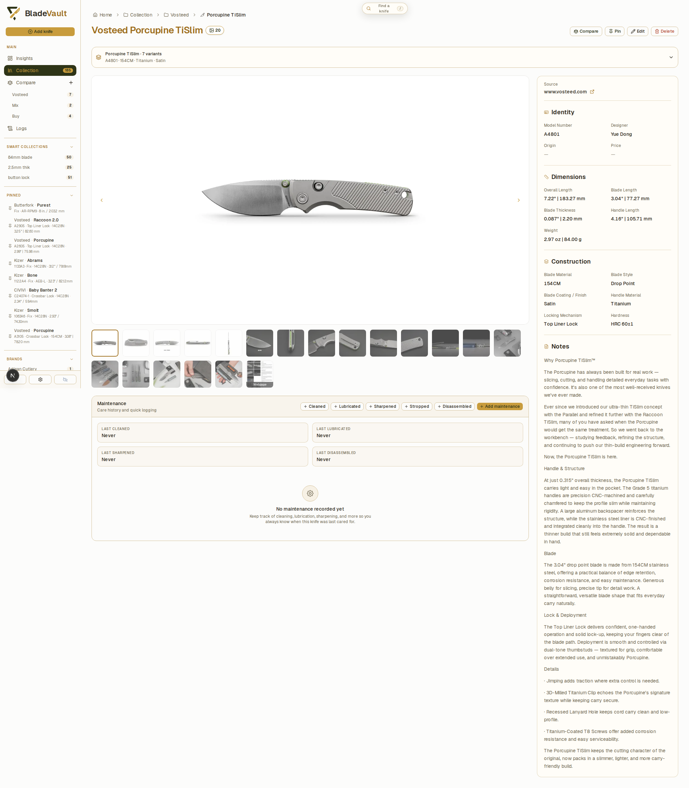
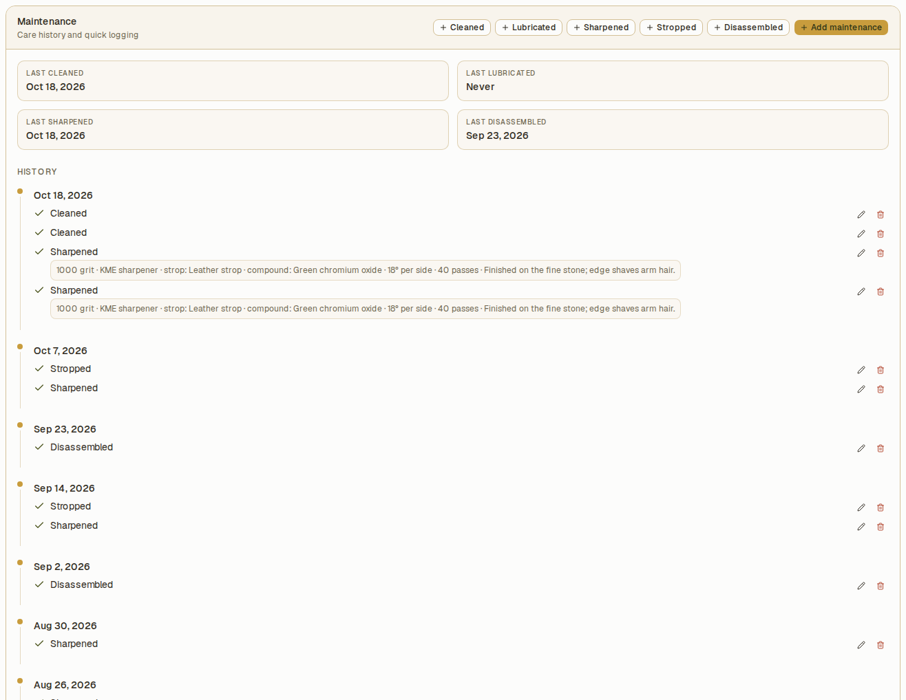

# Organize your collection

Use the collection to find records, group model variants, and update several knives at once. The guides below explain each workflow.

## Records

Each knife record can hold specifications, pricing, provenance, notes, links, and local photos. Add [custom text, number, and date fields](custom-fields.md) for details such as a preferred sharpening angle or purchase channel.

## Cards and the pinned sidebar

[Choose which details appear on cards](customize-appearance.md), and pick a separate set of fields for pinned sidebar items under **Settings → Appearance → Pinned item fields**. Pinned items show blade material and blade length by default. You can also change the theme, time format, and whether pinned knives appear first.

## Finding things

- [Search, filter, and sort your collection](search-and-filter.md) by model name, saved field values, or measurement ranges.
- Use **global search** to find a model name or enter `/model A4301` to search model numbers.

  

- [Pin or edit several knives at once](bulk-actions.md) from the collection's selection controls.

  

## Smart collections

[Save a search or filters as a Smart Collection](smart-collections.md) to reuse them. For example, save knives with a particular blade material and titanium handles, or knives with a blade length of at least 70 mm and under 90 mm. Matching records update as you add or edit knives.

## Model families

[Browse model families and variants](model-families.md) to see records with the same brand and model name together. Open a family to preview its variants and move between their individual records.

## Notes

Add a dated note from **My notes** on a record, then format it with the toolbar: bold, italic, strikethrough, a heading, quote block, bulleted or numbered list, inline code, code block, link, table, and divider. **Preview** shows how the note will read, and `Ctrl`/`Cmd`+`B`, `I`, and `K` apply bold, italic, and link to the selection. Notes are stored as Markdown, so plain notes keep their original line breaks and older notes render unchanged. Notes stay within the vault and are limited to 10,000 characters each.

## Maintenance history

[Log maintenance and sharpening](log-maintenance.md) with dates, notes, and sharpening details. [Review collection activity in History](review-collection-activity.md) to see maintenance events and record changes.

## Next

- [Compare knives](compare.md) — build shortlists and export comparisons.
- [Collection insights](insights.md) — makers, materials, dimensions, completeness.
- [Improve collection data quality](improve-data-quality.md) — review missing specifications, measurements, and inconsistent labels.
