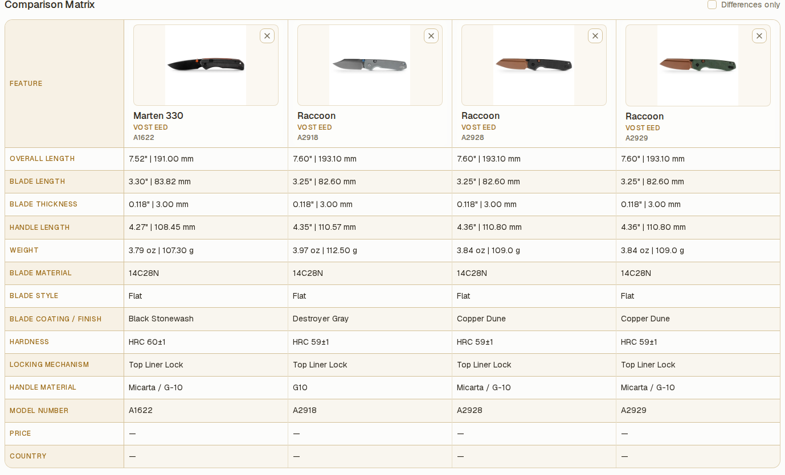

# Compare knives

Comparisons are saved as named lists, such as "Next purchase", "EDC rotation", or "Gift ideas". A knife can belong to several lists. Open **Compare** from the navigation to work with your shortlists.

## Create a comparison

1. Select the **+** button beside **Compare** in the navigation. If you have no comparisons, you can also select **New comparison** on the Compare page.
2. Enter a **Comparison name** between 1 and 60 characters, then select **Create comparison**.
3. Select **Add knives** on the new list.
4. In the **Add knives** dialog, search by name, brand, steel, or model number, then select **Add** beside each knife you want to include.
5. Select **Done** to close the dialog.

The saved list now shows your knives in a comparison matrix. Select a different list under **Compare** in the navigation to switch shortlists. On a narrow screen, the Compare page also has a list selector.

The separate inline search on the Compare page searches model names with ordinary text. Use `/model 535` to search model numbers there. This differs from the broader search in the **Add knives** dialog.

## Add a knife from its record

1. Open a knife in **Collection** and select **Compare**. If it already belongs to a list, the button shows **In 1 list** or the number of lists instead.
2. With no existing lists, enter a name and select **Create & add**.
3. With one existing list, the button adds the knife directly. Selecting it again removes that knife from the list.
4. With several lists, select or clear the relevant checkboxes in **Choose comparisons**, then select **Save selection**. You can also create a **New comparison** from that dialog.

Each list keeps its own membership. To add several selected collection records at once, see [Edit and pin several knives at once](bulk-actions.md).

## Show only the differences

1. Open a list containing at least two knives.
2. Enable **Differences only** above the comparison matrix.
3. Review the remaining rows. Disable the option to show every displayed specification again.

Rows with the same displayed value for every knife are hidden. If no rows remain, the page shows **No differences in the displayed specifications**. This compares the saved values; it does not verify their accuracy. On a narrow screen, swipe or scroll horizontally to see more columns.

## Manage a saved list

Open **Comparison options** using the three-dot button beside the list actions, then choose an action:

| Action                               | Result                                                                                                                              |
| ------------------------------------ | ----------------------------------------------------------------------------------------------------------------------------------- |
| **Rename comparison**                | Change the saved list's name. Enter the new name and select **Save name**. The pencil beside the page title also opens this dialog. |
| **Duplicate comparison**             | Create another saved list containing the same knives.                                                                               |
| **Remove all knives from this list** | Empty the list and keep its name. Confirm with **Remove all knives**.                                                               |
| **Delete comparison**                | Remove the saved list. Confirm with **Delete comparison**.                                                                          |

To remove one knife, select its **Remove** button in the lineup or at the top of its matrix column. Removing a knife from a comparison, clearing a list, or deleting a list keeps the knife in your collection and in its other comparison lists.

## Print and export

1. Open the saved list and choose whether to enable **Differences only**.
2. Select **Export PDF** to download a PDF, or **Print** to open the print dialog.
3. Save or print the result using the available dialog controls.

Both actions use the specifications currently shown in the matrix, including the **Differences only** selection. Add at least one knife to enable these actions.

## Backups and upgrades

Saved comparisons are included in full-vault backups and [cloud backups](../reference/cloud-backup.md). Changing a comparison list does not trigger an automatic cloud backup by itself; make a manual backup after important list changes. When upgrading from a version before v1.2.0, the old comparison selection becomes **My comparison**.

## Related

- [Organize your collection](collection.md) — filters, Smart Collections, model families.
- [Edit and pin several knives at once](bulk-actions.md) — add a selection to comparison lists.
- [Back up and restore your vault](back-up-and-restore-your-vault.md) — preserve your saved lists with the rest of the vault.
