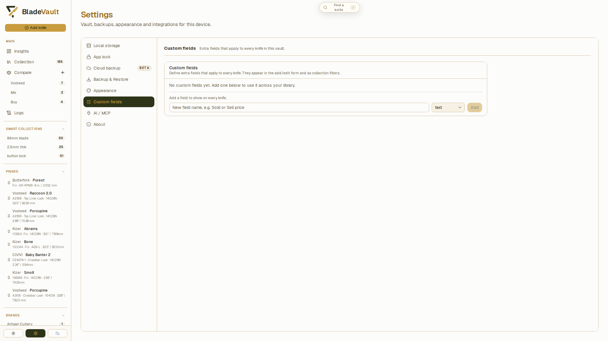
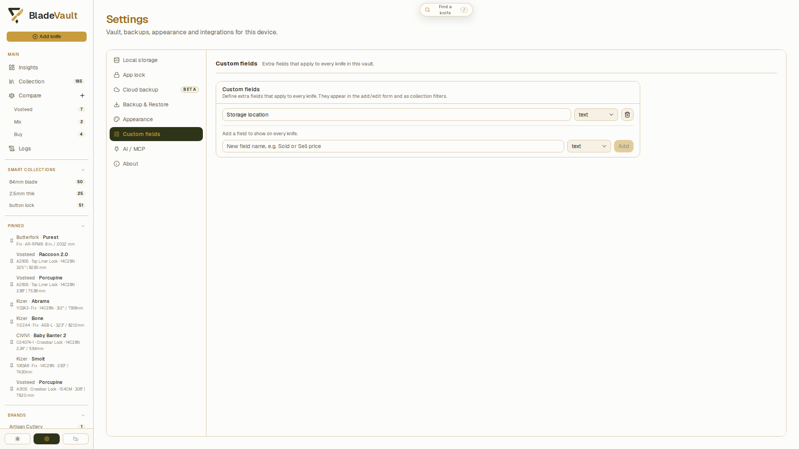
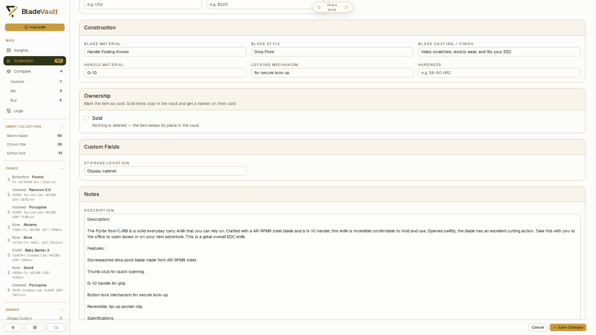
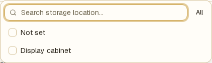
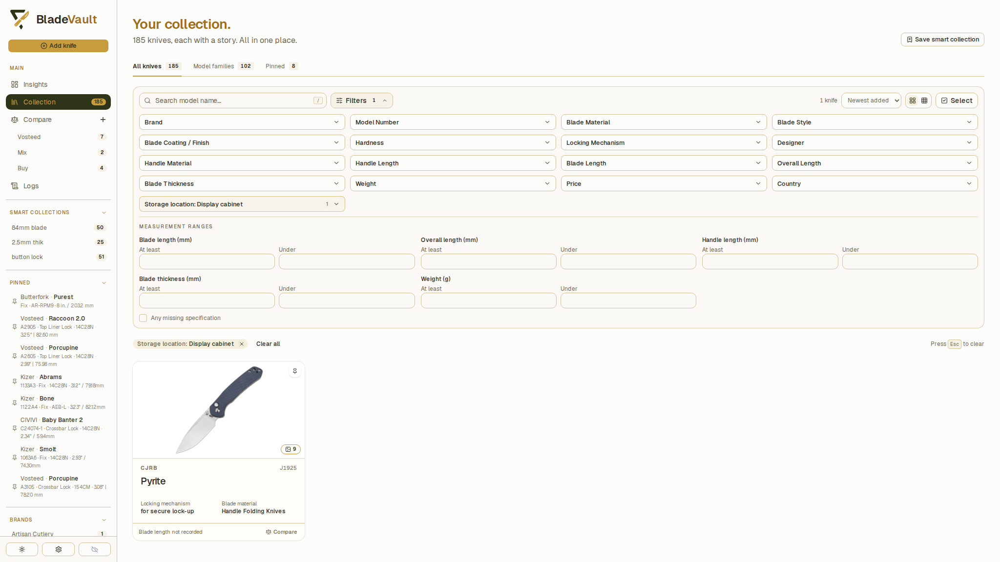

# Add and manage custom fields

Custom fields store details that the built-in fields do not cover, such as a purchase channel, storage location, or preferred sharpening angle. Define a field once in **Settings → Custom fields**, then enter a separate value for each knife.

## Create a field

1. Open **Settings → Custom fields**.
   
2. Enter a name in the new-field box. Use a clear label, such as `Storage location`.
3. Choose the field type:

   | Type       | Use it for                                     | Example                                 |
   | ---------- | ---------------------------------------------- | --------------------------------------- |
   | **Text**   | Words, labels, or a mix of letters and numbers | `Display cabinet`                       |
   | **Number** | Numeric values, including decimals             | `17.5` for a preferred sharpening angle |
   | **Date**   | A calendar date                                | A purchase date                         |

4. Click **Add**. The field appears in the list and becomes available throughout the vault.
   

A new field does not fill existing records automatically. Its value stays empty until you add one to a knife.

## Enter values on a knife

1. Open a knife and click **Edit**.
2. Find the **Custom Fields** section and enter a value under the field's name.
   
3. Click **Save Changes**.
4. Return to the record and check the saved value.

Custom fields also appear when you add a knife. Use the number or date input appropriate to the field's type; you can leave an optional value empty.

To give several knives the same value, use [bulk editing](bulk-actions.md).

## Filter by a custom field

1. Open **Collection** and click **Filters**.
2. Find the filter with your custom field's name.
3. Select one or more saved values. Choose **Not set** to find knives without a value, when that option is available.
4. Combine it with other filters or save the result as a [Smart Collection](smart-collections.md).
   

The filter offers values already saved in your collection. Number and date fields use the same value-selection control as text fields; they do not add custom numeric or date-range controls.

## Show a field on cards

Open **Settings → Appearance**. Under **Card fields**, check the field in the **Custom fields** group. The same selection controls details on knife cards and pinned sidebar items. Empty values are omitted.

See [Customize cards and collection appearance](customize-appearance.md) for the preview and display options.

## Rename, change, or remove a field

Open **Settings → Custom fields** and edit the existing row:

- **Rename:** change the name in the text box. The field keeps its existing values under the new label.
- **Change type:** choose **Text**, **Number**, or **Date**. This changes the input used when you edit a knife; it does not convert existing values. Review and update those values if needed.
- **Remove:** click the trash button next to the field. The definition disappears immediately, without a confirmation dialog, and is removed from card-field selections. There is no field-deletion undo in Settings. [Save a backup](back-up-and-restore-your-vault.md) first if you may need to recover it.

Definition changes save automatically; there is no separate Save button in this panel. Changes to a knife's values still require **Save Changes** in its edit form.

## Related

- [Update a saved knife](update-a-saved-knife.md) — edit the rest of a record.
- [Search, filter, and sort your collection](search-and-filter.md) — combine custom values with other filters.
- [Edit and pin several knives at once](bulk-actions.md) — apply a shared value to selected records.
