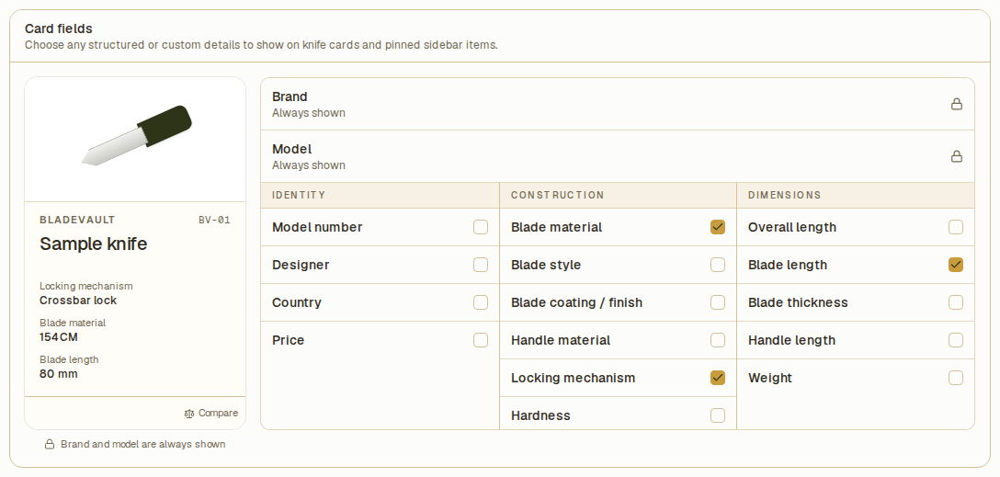
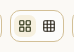
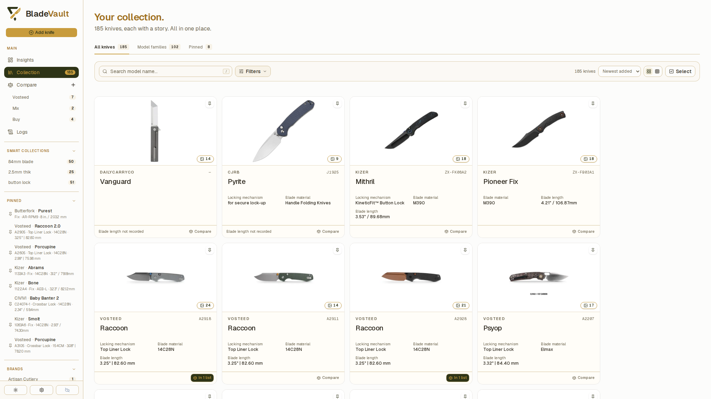
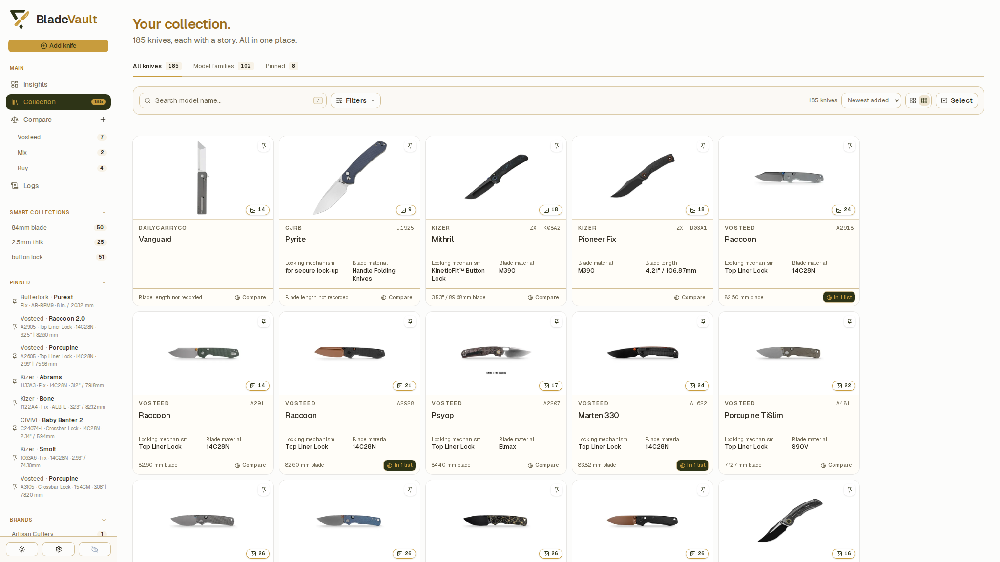
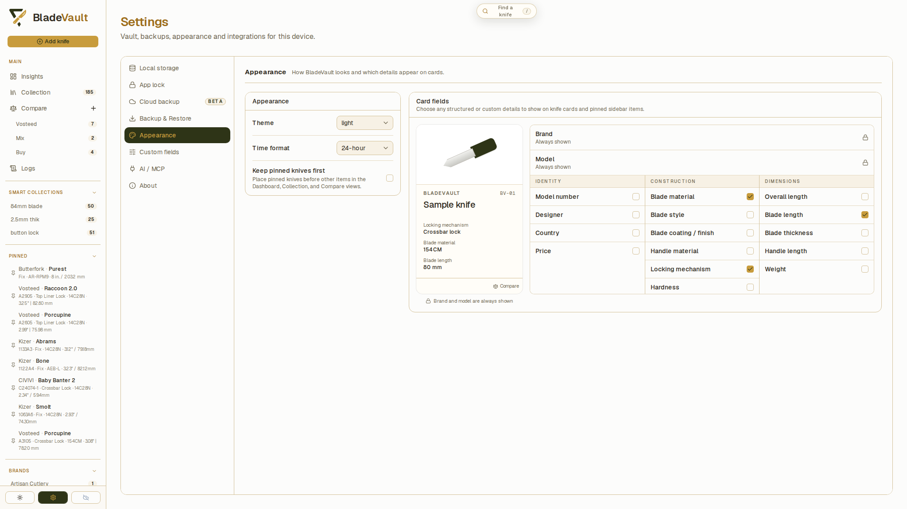
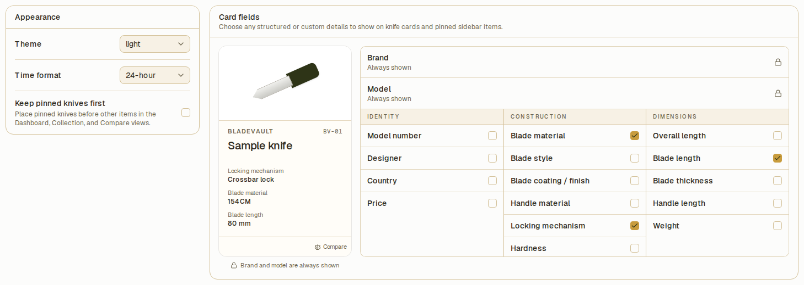

# Customize cards and collection appearance

Choose the details you want to see while browsing and adjust BladeVault's theme, time format, and pinned ordering. Open **Settings → Appearance** for the preferences that apply across the vault.

## Choose the details on knife cards

1. Open **Settings → Appearance** and find **Card fields**.
2. Check the fields you want to display. The groups cover identity, construction, dimensions, and any custom fields you have defined.
   
3. Use the sample card to review your selection. It uses example values so you can see the layout even when your collection has empty fields.
4. Return to **Collection** and check a knife that has values for the selected fields.

Changes save automatically. Brand and model stay visible. The model number has a dedicated place on the card, so selecting it does not create a second copy in the detail rows. Empty optional values are omitted on real cards.

The same field selection also controls the details shown for knives in the **Pinned** sidebar. You do not need to configure the sidebar separately.

For example, choose **Blade material**, **Handle material**, and **Weight** to see those specifications at a glance. Add a [custom field](custom-fields.md) first if you want to display a detail such as storage location.

## Switch between Gallery and Compact views

Open **Collection** and use the two card-density buttons next to the sort control:

- **Gallery view** gives each card more space for the image and selected details.
  
- **Compact view** fits more cards on screen. It shows up to two selected detail rows on larger screens and hides those rows on phones.
  

Changing density does not change the saved specifications or your card-field selection. A variant summary may appear in place of the selected detail rows when you browse variants within a model family. Open the knife to see its full record.

Card density is a control on the Collection page. It is separate from the appearance preferences saved in Settings.

## Keep pinned knives first

1. Open **Settings → Appearance**.
2. Enable **Keep pinned knives first**.
   
3. Return to Insights, Collection, or Compare to see pinned knives before other items.

Disable the preference to follow each view's normal order. This changes ordering; it does not remove any pins. To pin or unpin a knife, use its pin control, or use [bulk actions](bulk-actions.md) for several records.

## Change the theme and time format

In **Settings → Appearance**:

1. Under **Theme**, choose **Light** or **Dark**.
2. Under **Time format**, choose **12-hour** or **24-hour**.
   

Both preferences save automatically. The time format controls how times are displayed, including activity and backup timestamps; it does not change the dates stored in your records.

## Related

- [Add and manage custom fields](custom-fields.md) — create extra details for cards and records.
- [Browse model families and variants](model-families.md) — switch between individual knives and grouped models.
- [Search, filter, and sort your collection](search-and-filter.md) — choose which knives to display and how to order them.
