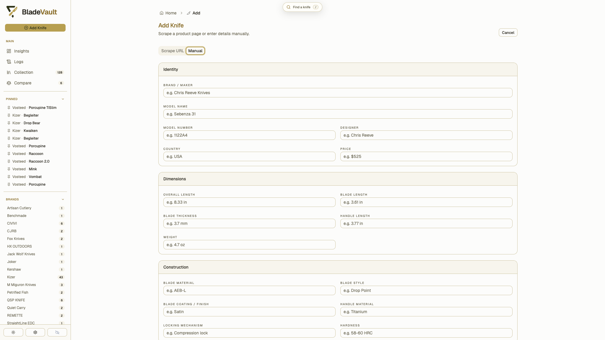

# Import knives from a product URL

BladeVault can fill a record for you instead of you typing a dozen specifications by hand.

## Import from a supported retailer URL

1. Open **Add**.
2. Paste the product URL and start the import.
3. Review the imported values — specifications, pricing, and the product images — and adjust anything that needs it before saving.

Import works against supported retailer URLs. BladeVault automatically clears recognizable newsletter and cookie overlays before capturing the page. In the comparison preview, use **Hide popups** to remove remaining dialogs, or **Restore original** to return to the imported preview. These controls leave your form edits unchanged.

For popups that need a real click, or retailer verification, choose **Interact with page** beside the URL. Close the popup in the browser window, then click **Continue** in BladeVault to refresh the import. Manually edited fields and image selections are kept. The browser window opens on the computer running BladeVault; a browser running inside a remote container is not streamed to your screen.

## Add a knife manually

Every field is available by hand, which is the right path for a knife with no product page — a gift, a custom build, an older piece with no online listing. Along with the built-in specifications you can store pricing, provenance, notes, links, and local photos.

## Photos

Local photos live in the vault folder next to the database, so they travel with your data and are included in ZIP backups and [cloud backups](../reference/cloud-backup.md). Product images imported from a URL are downloaded into the same place.

## Capture the source page

If you want a permanent image of the page you imported from, BladeVault can save a full-page screenshot with the import. See [Capture source pages](capture-sources.md).

## Requirements

- **From source:** install Chromium (`npx playwright install chromium`) so URL import and capture can run.
- **Docker, desktop, Kubernetes:** the shipped image and desktop build already include the browser runtime.
