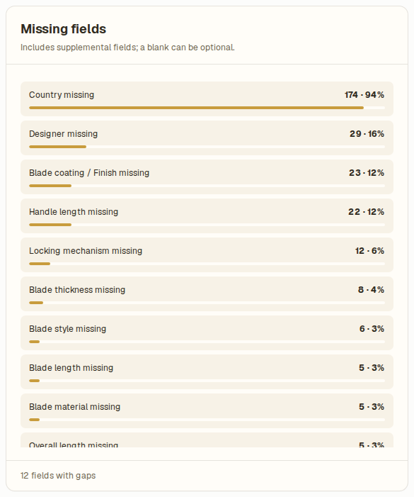
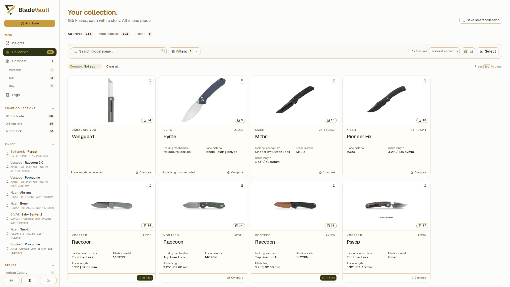
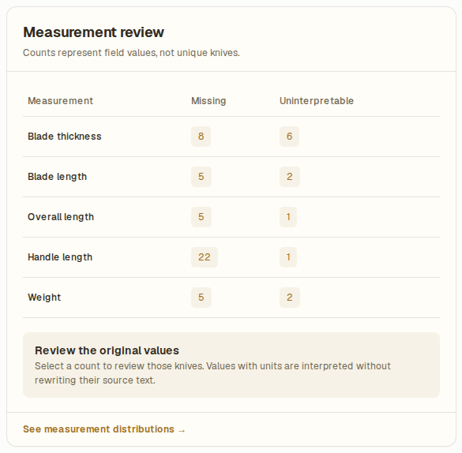
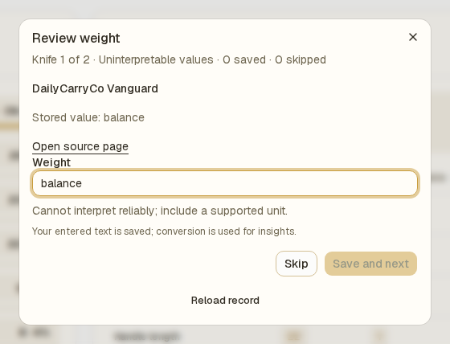
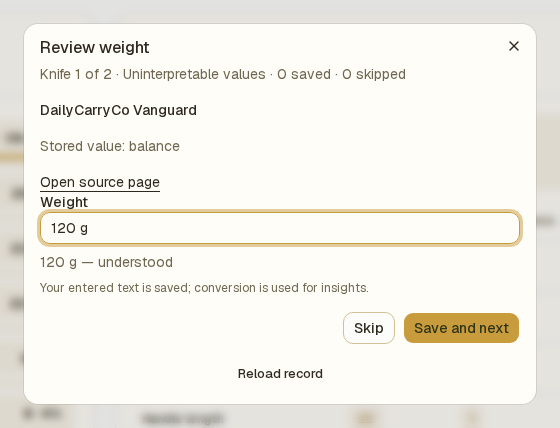
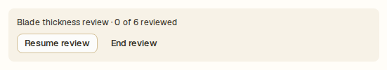
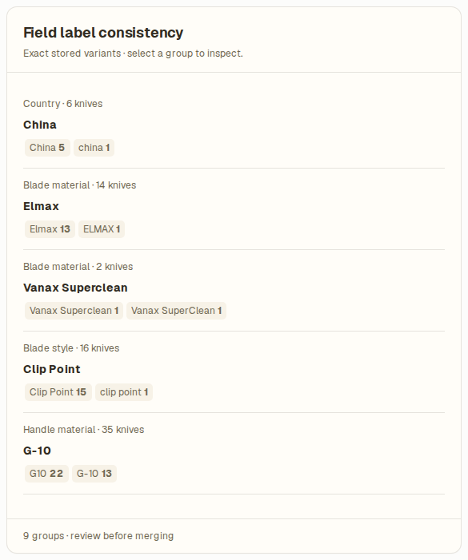
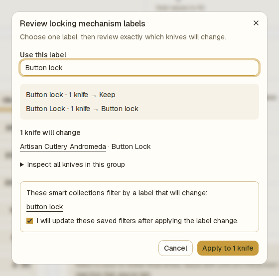
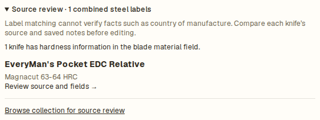

# Improve collection data quality

Use **Insights → Data completeness** to find gaps in your catalog, review measurements, and make field labels consistent. The page separates three tasks: finding missing fields, reviewing measurements one knife at a time, and applying a label change to a group of records.

The completeness score counts populated core fields. It does not establish whether a value is correct, and a missing supplemental field may be appropriate for a particular knife.

## Find records with a missing field

1. Open **Insights**, then open **Data completeness**.
2. Under **Missing fields**, select the field you want to review.

   

3. BladeVault opens **Collection**, filtered to knives with that field unset.

   

4. Open a matching knife, check its saved source or your own information, and edit the record if you can supply the value.
5. Save the record and return to the filtered collection to continue.

Saved values are reflected in the collection and insights. Missing-field links help you find records; the guided **Save and next** workflow below is specifically for measurements.

## Review missing or uninterpretable measurements

**Measurement review** covers blade thickness, blade length, overall length, handle length, and weight. **Missing** means the saved value is blank. **Uninterpretable** means BladeVault cannot reliably read it as a measurement.

1. Under **Measurement review**, select a count in the **Missing** or **Uninterpretable** column for the measurement you want to fix.

   

2. Review the knife name and **Stored value**. Use **Open source page** if a source link is available, or check your own measurements.

   

3. Enter a value with a supported unit, such as `3 mm` for blade thickness or `120 g` for weight.
4. Check the interpretation shown below the input. Lengths are previewed in millimeters and weight in grams.

   

5. Select **Save and next** when the preview matches the intended measurement, or **Skip** if you cannot establish the value.
6. Continue through the queue, then select **Finish review**.

Your entered text is saved. The conversion is used for insights; it does not replace the text with the preview value. Saving stays disabled while the measurement cannot be interpreted. Skipping leaves the record unchanged and available in the review lists.

Counts represent field values. A knife with two measurement issues can contribute to more than one count.

### Pause and resume

Close the review dialog to pause. Select **Resume review** in **Measurement review** to return to the current queue, or **End review** to discard its progress. Values already saved remain saved.

Review progress is kept for the current browser session, so you can navigate away or reload and then resume in the same session. If browser storage is unavailable, progress is kept in memory only. This progress is separate from the saved knife data and is not shared between devices.

If a record changes during your review and saving fails, use **Reload record** to read its latest values before continuing. A record that is no longer available can be skipped.

## Standardize field labels

**Field label consistency** finds case and whitespace variants across country, designer, blade material, blade style, brand/maker, handle material, locking mechanism, and blade coating/finish. It also recognizes the known `G10` / `G-10` handle-material spelling variation. It does not discover arbitrary synonyms or verify that a material or country is factually correct.

1. Under **Field label consistency**, select a group of variants.

   

2. Review the suggested value in **Use this label** and edit it if needed.
3. Check the before-and-after labels and the list of knives that will change. Records already using the target label are kept as they are.
4. Review any affected Smart Collections. If a saved filter uses a label that will change, acknowledge that you will update that filter afterward.

   

5. Select **Apply to … knives** to save the previewed label change.
6. Update the affected Smart Collection filters to use the new label.

The change updates the affected knife records. Smart Collection filters are not rewritten automatically. If the preview reports an error or the collection changes while you are reviewing it, close and reopen the preview to inspect the latest records.

## Check facts against the source

Expand **Source review** beneath the label groups to inspect blade-material labels that may include hardness information. Open a listed knife and compare its source and notes before editing the relevant fields.

This list points out records worth checking. BladeVault does not automatically separate a steel name from hardness information or verify a knife's specifications.

## Related

- [Collection insights](insights.md) — understand the summaries your records produce.
- [Update a saved knife](update-a-saved-knife.md) — edit individual records.
- [Create and manage Smart Collections](smart-collections.md) — update saved filters after a label change.
- [Review collection activity in Logs](review-collection-activity.md) — inspect the saved changes.
