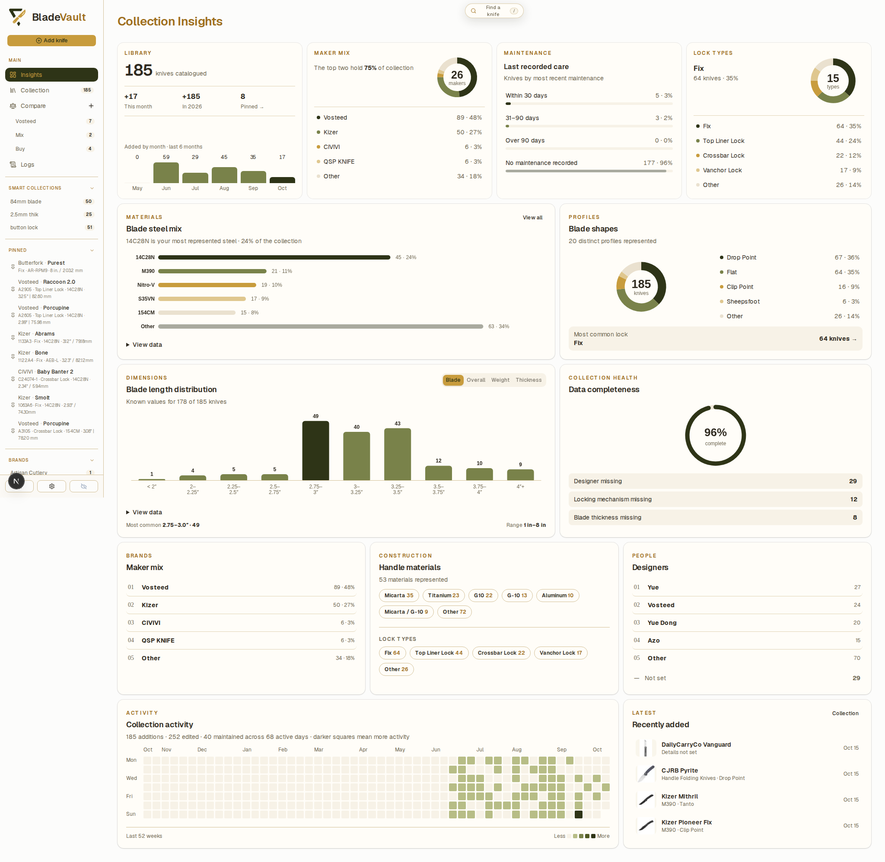
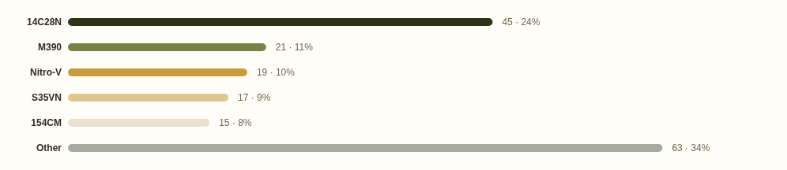
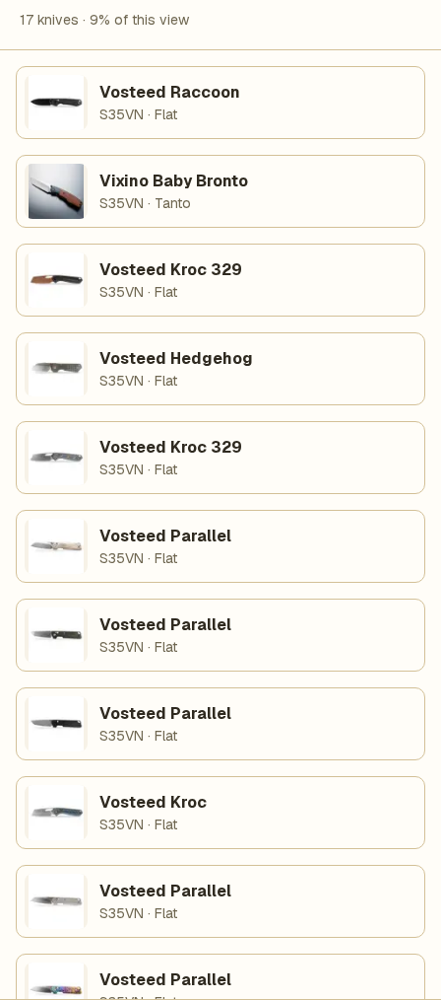
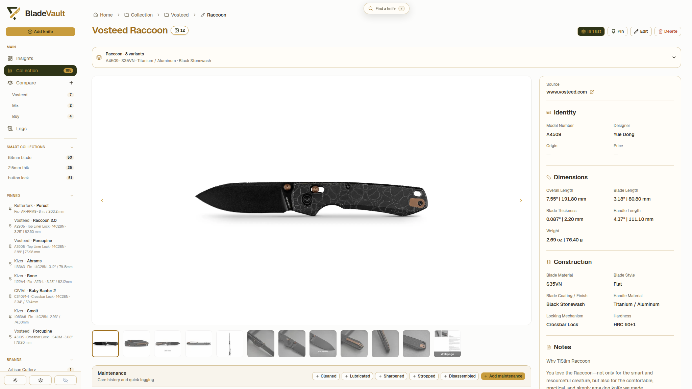
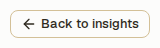
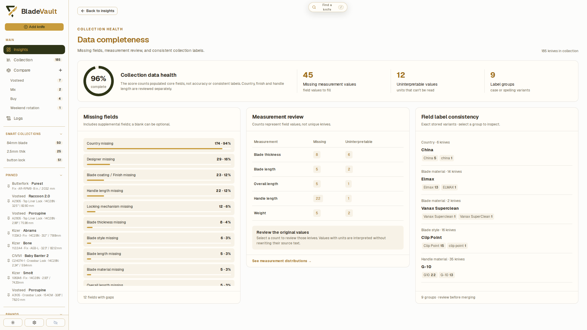
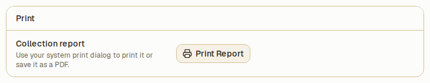

# Collection insights

Insights summarize your collection: the makers you collect, the materials and sizes represented, gaps in your records, and collection activity over time. Open **Insights** from the navigation to explore them.

## What you can read from it

- **Makers** — how many knives you own from each maker.
- **Materials and dimensions** — blade steels, handle materials, and size ranges across the collection.
- **Data completeness** — missing fields, measurements that cannot be interpreted, and inconsistent labels.
- **Activity** — additions, edits, and maintenance over time.

## Explore an insight

1. Open **Insights** and find the chart or summary you want to investigate.

   

2. Open its detail page for a fuller breakdown. Where a chart offers a selection, choose a value to inspect its matching knives.

   

3. Open a knife from the results to inspect its saved specifications or make an edit.

   

4. Use **Back to insights** on a detail page to return to the overview.

   

The matching records explain the count or distribution you selected. Missing values and inconsistent labels can affect those summaries, so check the records before drawing conclusions.

## Improve the underlying records

Open **Data completeness** for three ways to review your catalog:

- Select a missing-field count to browse records with that field unset.
- Review missing or uninterpretable measurements one knife at a time.
- Review label variants before applying a consistent value to several knives.

The completeness score measures populated core fields, not factual accuracy. A blank supplemental field may be appropriate for a particular knife. See [Improve collection data quality](improve-data-quality.md) for the full review workflow.

## Print a report

Use **Print Report** in **Settings → Backup & Restore** to open the Overview for printing or saving as a PDF.

## Related

- [Improve collection data quality](improve-data-quality.md) — missing fields, measurement review, and consistent labels.
- [Review collection activity in Logs](review-collection-activity.md) — inspect individual events and before-and-after values.
- [Organize your collection](collection.md) — filters, Smart Collections, and model families.
- [MCP](../reference/mcp.md) — use `find_missing_fields` from a connected AI client.
