# Log maintenance and sharpening

Maintenance records the care you perform on each knife, including when it happened and any useful details. Open a saved knife from **Collection**, choose **Open full page →** in its preview, then scroll to **Maintenance**.

## Log a quick entry for today

1. In **Maintenance**, select **Cleaned**, **Lubricated**, **Sharpened**, **Stropped**, or **Disassembled**.

   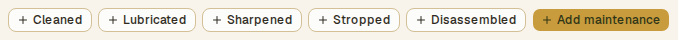

2. Wait for the entry to appear under **History**.

   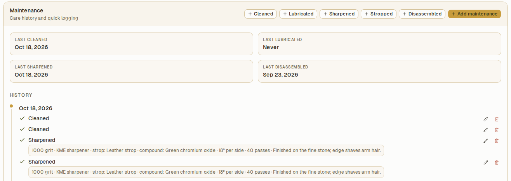

The selected action saves an entry immediately with the current date and time and no notes. Each press creates an entry. Use **Add maintenance** when you want to choose a date or include details.

## Add a dated entry with notes

1. Select **Add maintenance**.

   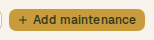

2. Set **Date** to the day the work took place.

   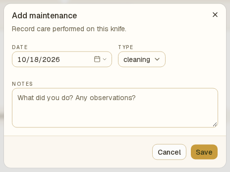

3. Choose **Type**. Alongside the quick actions, the form offers **Reassembled**, **Hardware replaced**, **Part replaced**, and **Other**.

   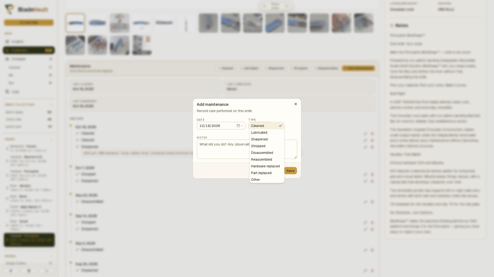

4. Describe the work or observations in **Notes**.
5. Select **Save**.

The entry appears in the knife's history under its chosen date. The summary shows the latest recorded cleaning, lubrication, sharpening, and disassembly dates; **Never** means no entry of that type has been recorded.

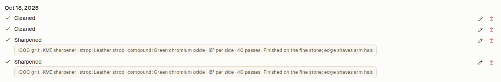

## Record sharpening or stropping details

1. Select **Add maintenance**, or edit an existing entry.
2. Choose **Sharpened** or **Stropped** as the type to reveal **Sharpening details**.

   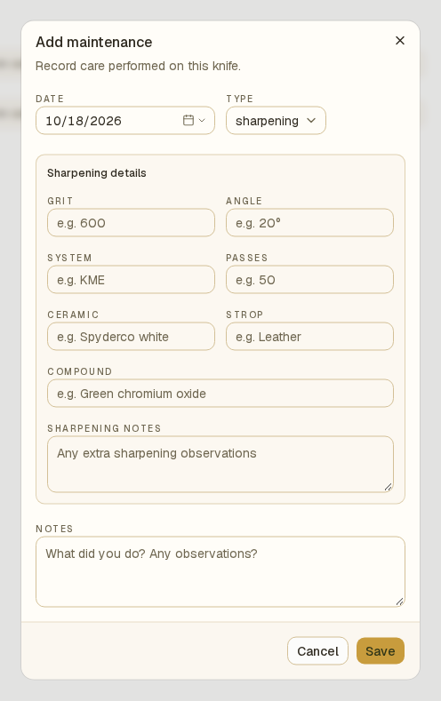

3. Fill in the details you want to keep:

| Field                | What to record                                                                  |
| -------------------- | ------------------------------------------------------------------------------- |
| **Grit**             | The abrasive grit or progression you used.                                      |
| **Angle**            | The sharpening angle, including any useful convention such as degrees per side. |
| **System**           | Your sharpening system or equipment.                                            |
| **Passes**           | A nonnegative whole-number count of passes.                                     |
| **Ceramic**          | The ceramic abrasive you used.                                                  |
| **Strop**            | The strop material or product.                                                  |
| **Compound**         | The stropping compound.                                                         |
| **Sharpening notes** | Extra observations about the edge or technique.                                 |

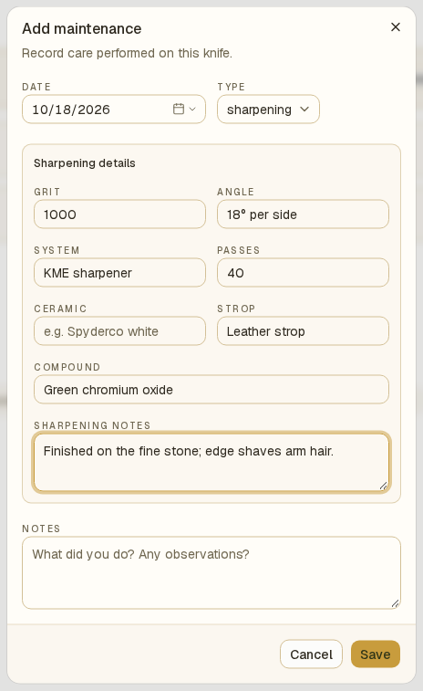

4. Add any general **Notes**, then select **Save** or **Save changes**.

These details are optional and appear with the entry in **History**. They describe that maintenance event; they do not replace the knife's specifications or create a maintenance schedule.

## Correct or delete an entry

1. Find the entry under **History**.
2. Select its pencil button, **Edit maintenance entry**.

   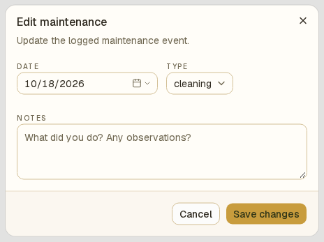

3. Correct the date, type, notes, or sharpening details and select **Save changes**.

To remove an entry, select its trash button, **Delete maintenance entry**, and confirm **Delete this maintenance entry?** The entry disappears from the knife's maintenance history. The latest-date summary updates to reflect the remaining entries.

## Review care across the collection

Open **Logs** and select **Maintenance** to see maintenance activity for all knives. Expand an event to inspect its details. Logs also records edits and deletions, so it is useful when you need to understand a change to the history.

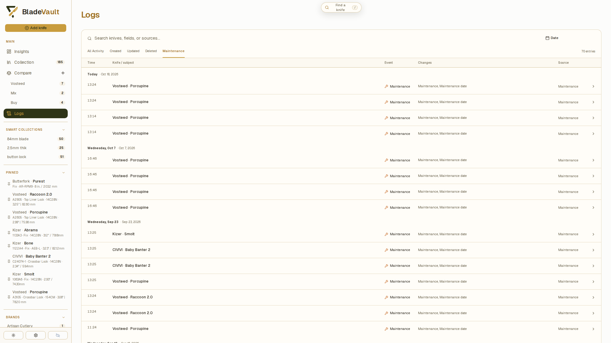

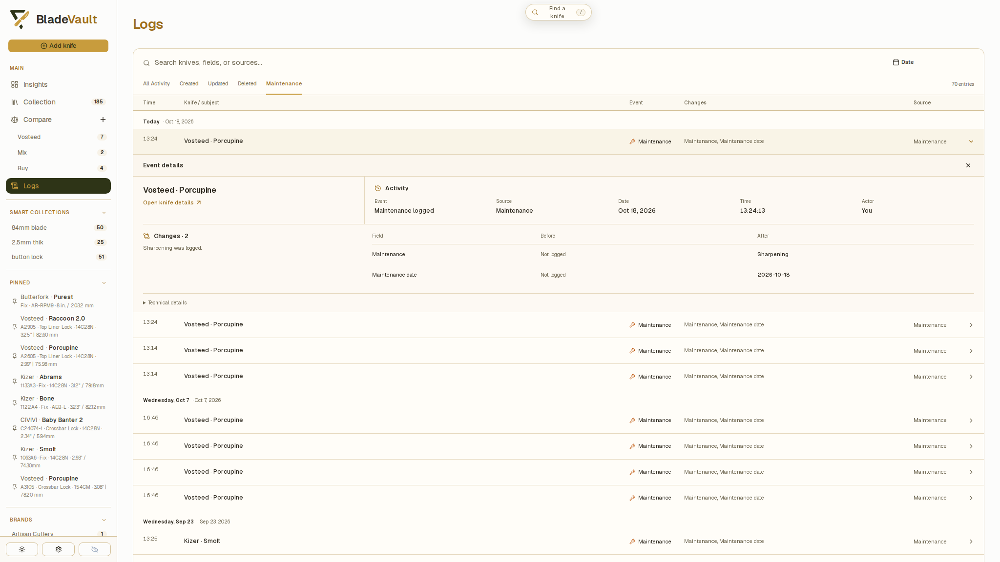

## Related

- [Review collection activity in Logs](review-collection-activity.md) — search and filter recorded events.
- [Update a saved knife](update-a-saved-knife.md) — edit the knife's specifications and other fields.
- [MCP](../reference/mcp.md) — read maintenance history or allow a connected client to add an entry.
- [Back up and restore your vault](back-up-and-restore-your-vault.md) — preserve maintenance history with your collection.
