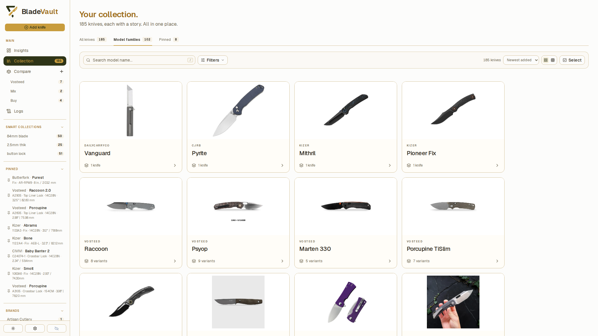
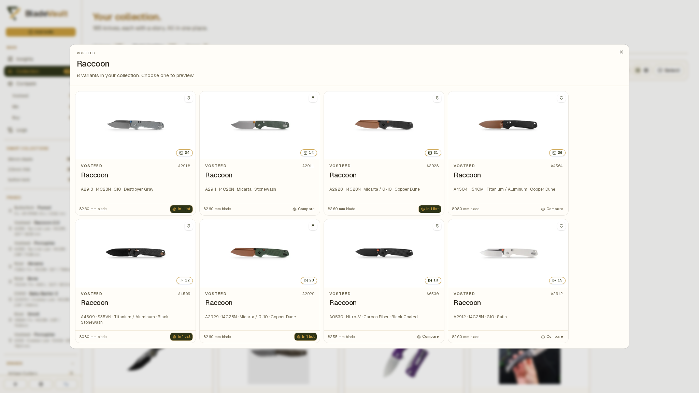
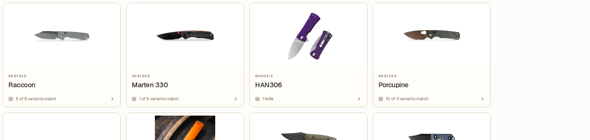

# Browse model families and variants

Model families bring records with the same brand and model name together. Use them to browse different steels, handles, finishes, or model numbers while keeping a separate record for each knife.

Open **Collection** from the sidebar, then choose **Model families** above the cards.

## Open a family

1. Choose **Model families** in **Collection**.
2. Find a family by browsing, entering its model name in search, or applying **Filters**.

3. Click a family card. A family with several variants opens a dialog showing its matching records. A family with one record opens that knife's preview directly.

4. Choose a variant to open its preview.
5. Click **Open full page →** for the complete record, or **Edit** to update it.

Each variant keeps its own specifications, photos, notes, maintenance history, and ownership status. Family browsing does not merge the records.

## Move between variants

1. Open a variant's preview in the collection.
2. Find the section showing the number of **variants in your collection**.
3. Click another variant's button to preview it. Model numbers identify the buttons when available.

On the full record page, expand the panel headed by the model name and variant count, then choose another variant. Its entries show available model number, blade steel, handle, and finish details. When these details cannot distinguish records, the variant label includes the record ID.

## Understand filtered families

Filters apply to individual records before BladeVault groups the results. A family remains visible if at least one of its records matches.

For example, if a family has three variants but only one has the selected blade material, its card shows **1 of 3 variants match**. Opening it shows that matching variant. The preview's variant buttons can still take you to other members of the family, including those outside the current filters.

The counts beside the collection tabs describe the whole vault. The matching count near the search controls describes the current filtered results.

## How grouping works

BladeVault groups records automatically by **Brand** and model **Name**. Differences in letter case or extra spaces do not separate them. Punctuation, size, and generation differences in the name remain distinct, so `Model`, `Model Mini`, and `Model 2` form different families.

Model numbers, blade materials, handle materials, and finishes describe variants; they do not determine family membership. A record without a brand or name remains separate rather than joining unrelated records.

If variants are unexpectedly separate, open their **Edit** forms and check the brand and model name for consistent spelling. Correct them only when they refer to the same model. There is no manual family assignment or family-merge control.

## Related guides

- [Search, filter, and sort your collection](search-and-filter.md) — narrow the variants you see.
- [Update a saved knife](update-a-saved-knife.md) — correct a brand, model name, or variant specification.
- [Compare knives](compare.md) — compare selected variants side by side.
- [Customize cards and collection appearance](customize-appearance.md) — choose card details and Gallery/Compact views.
