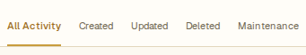
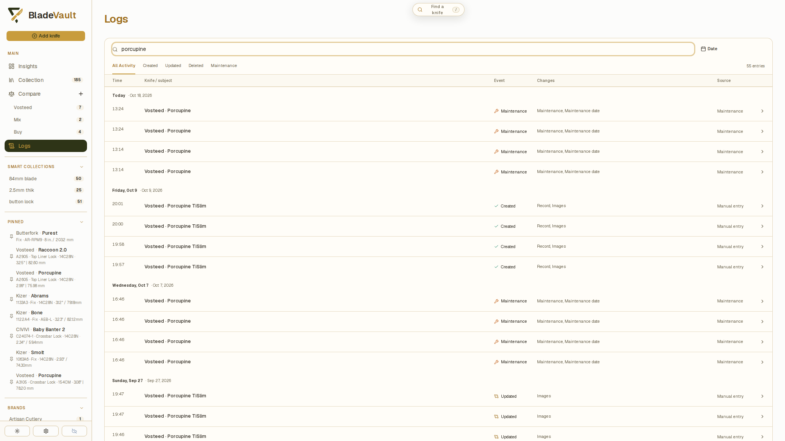
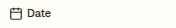
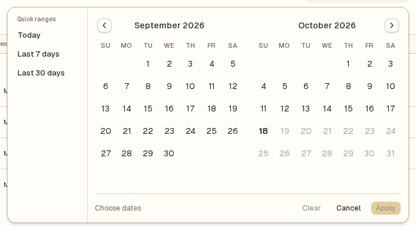
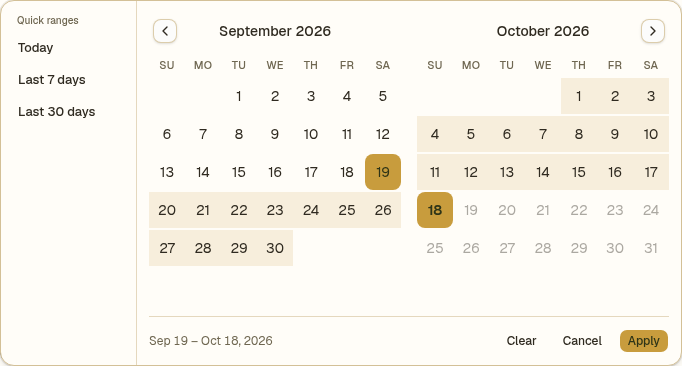
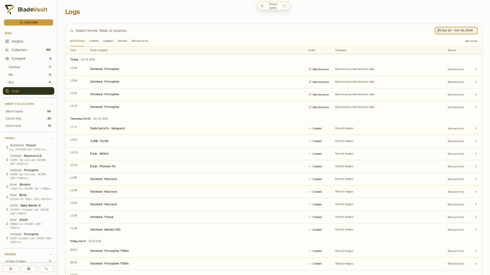
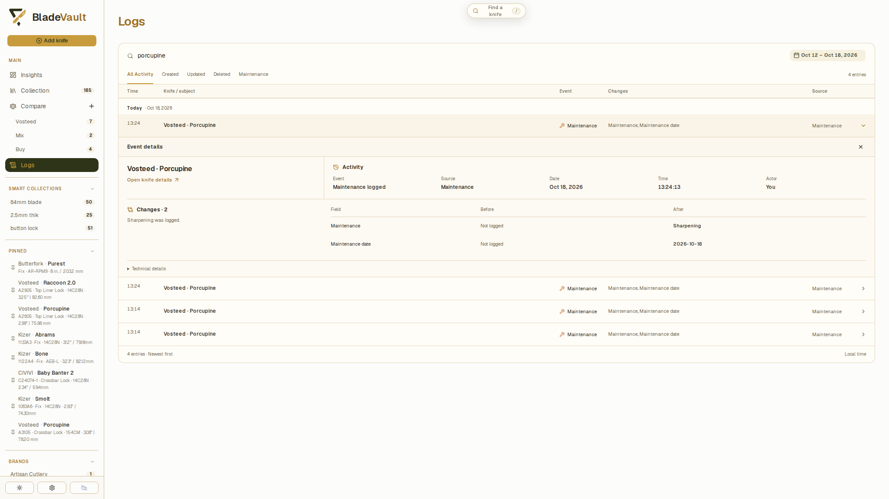
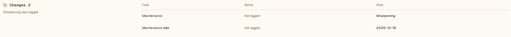
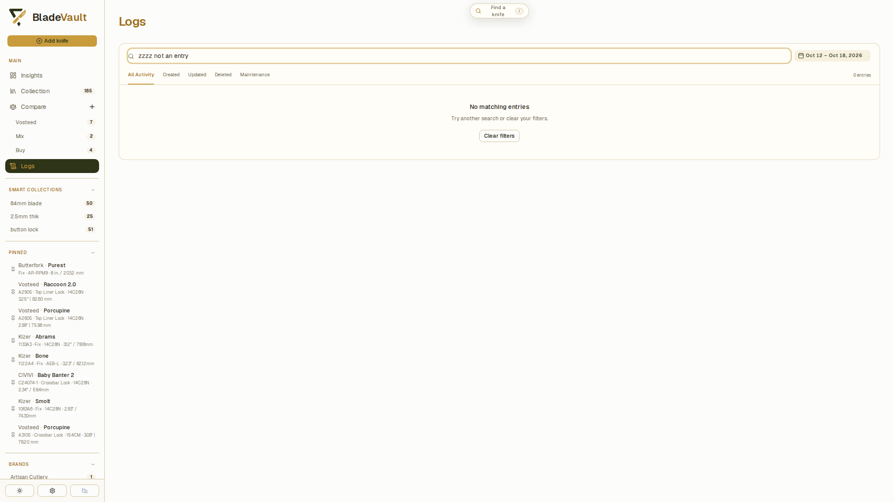

# Review collection activity in Logs

**Logs** shows recorded changes to your vault, including knife additions, metadata edits, deletions, and maintenance activity. Use it to find when a record changed, inspect before-and-after values, and identify the source of an update.

Open **Logs** from the navigation. Entries are shown newest first, grouped by day, using your local time.

## Find an event

1. Enter a knife name, field, value, or source in **Search logs**. The input shows **Search knives, fields, or sources…**.

   

2. Choose **All activity**, **Created**, **Updated**, **Deleted**, or **Maintenance** to narrow the event types.

   

3. Review the matching entries. Search also checks event summaries and recorded before-and-after values, so an old field value can help you find an earlier edit.

   

Search ignores letter case. Search, event type, and date filters work together, so an entry must match all active filters to appear. **Maintenance** includes logged, edited, and deleted maintenance entries.

## Filter by date

1. Select the calendar button, initially labeled **Date**.

   

2. Choose **Today**, **Last 7 days**, or **Last 30 days** for a quick range. The selected range is applied immediately.

   

3. For a custom range, select its first and last days in the calendar, then select **Apply**. Selecting just one day filters to that day.

   

4. Review the filtered entries. The button now shows the selected dates.

   

5. Reopen the calendar and select **Clear** to remove the date filter. **Cancel** closes the calendar without applying your draft selection.

Date ranges include their first and last days. The filter uses the date the activity was recorded. For maintenance performed on an earlier day, open the event details or the knife's maintenance history to inspect the entered maintenance date.

## Inspect what changed

1. Select the chevron at the end of an entry to expand **Event details**.

   

2. Review **Activity** for the event, source, date, and time.
3. Read **Changes** for the summary and any recorded **Field**, **Before**, and **After** values. A dash represents an empty value.

   

4. Select **Open knife details** to inspect the current record, when available.

   

5. Close the details using the close button or the entry's chevron.

A deleted knife may still have retained history, but its record can no longer be opened from that event. Some events have a summary without individual field changes.

Logs is a record of activity. To correct a specification or maintenance entry, open the knife and edit it there; the log does not provide an undo action.

## When no entries match

Clear the search, choose **All activity**, and remove the date range to broaden the results. When the page shows **No matching entries**, you can also select **Clear filters** to reset them together. **No log entries yet** means no activity has been recorded in the available history.

## Related

- [Update a saved knife](update-a-saved-knife.md) — correct the current record.
- [Log maintenance and sharpening](log-maintenance.md) — add, edit, or remove a care entry.
- [Improve collection data quality](improve-data-quality.md) — review missing values and inconsistent labels.
- [Collection insights](insights.md) — explore collection activity over time.
