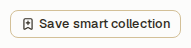
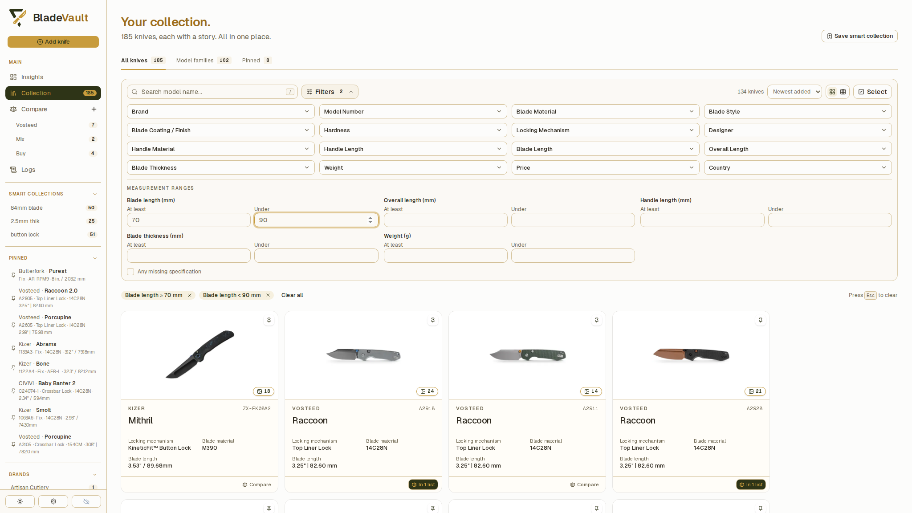
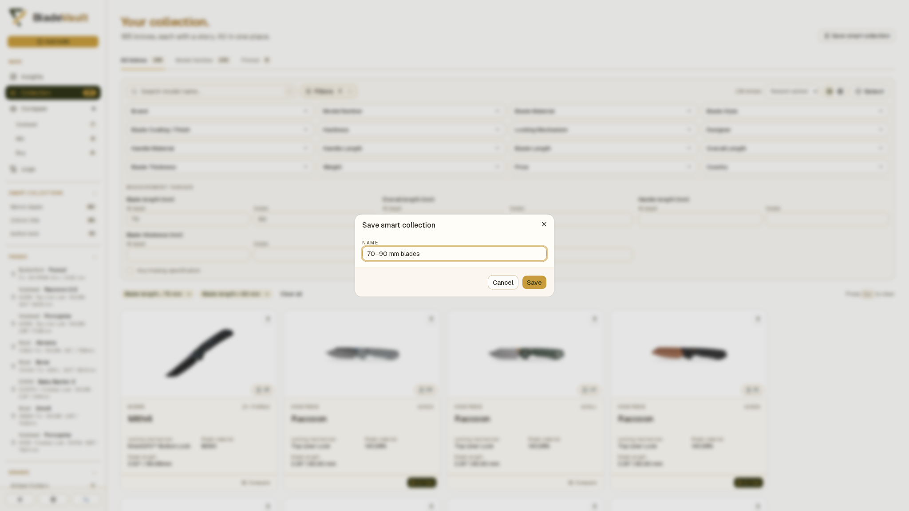
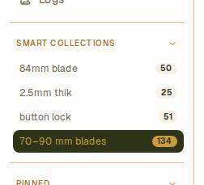
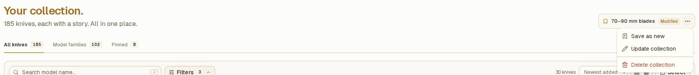
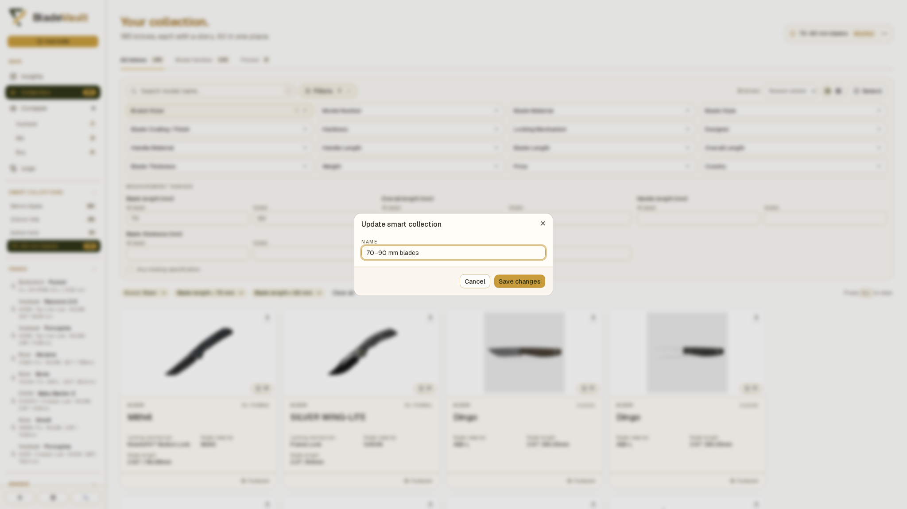
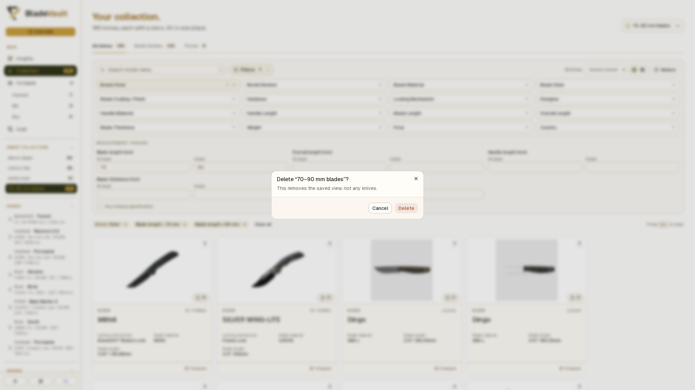

# Create and manage Smart Collections

A Smart Collection saves a search and filters as a named view. Its results update when you add or edit knives, so you can return to a useful subset without rebuilding the filters.

Open **Collection** from the sidebar to create or change a Smart Collection.

## Save a Smart Collection

1. Enter a model name in **Search model name…**, choose values under **Filters**, or combine both. You need at least one search term or filter.
2. Check the matching records. For example, choose a **Blade Material** and **Handle Material**, or use **Measurement ranges** to find blades of at least 70 mm and under 90 mm.

3. Click **Save smart collection** near the page heading.
4. Enter a **Name**, such as `Titanium handles` or `70–90 mm blades`. Names can contain up to 80 characters.

5. Click **Save**.

The saved name appears under **Smart collections** in the sidebar. Click it to open the saved search and filters. The number beside its name shows how many knives currently match.

## Change the name or filters

1. Open the Smart Collection from the sidebar.
2. Adjust its search or filters if needed. **Modified** appears beside the name when they differ from the saved version.

3. Open the three-dot menu beside the saved name and choose **Update collection**.
4. Change the **Name** if needed, then click **Save changes**.

The existing Smart Collection now uses the current search and filters. To discard unsaved filter changes, click its name in the sidebar again.

## Save a variation

1. Open an existing Smart Collection and adjust the search or filters.
2. Open its three-dot menu and choose **Save as new**.
3. Enter a different name and click **Save**.

You now have two saved views. The original keeps its previous filters.

## Delete a Smart Collection

1. Open the Smart Collection from the sidebar.
2. Open its three-dot menu and choose **Delete collection**.
3. Click **Delete** in the confirmation dialog.

This removes the saved view and its sidebar entry. All knife records remain in the vault.

## What a Smart Collection saves

Smart Collections save model-name search, built-in and custom-field filters, measurement ranges, and **Any missing specification**. They do not save the current sort order, Gallery/Compact layout, All knives/Model families/Pinned tab, or a selection of records.

Choose valid ranges before saving: each value must be non-negative, and the lower bound must be below the upper bound. If you remove every search term and filter, you cannot save that empty view.

There are no saved filters for notes or maintenance dates. Use the available field and range controls when building a Smart Collection.

## Related guides

- [Search, filter, and sort your collection](search-and-filter.md) — available filters and range boundaries.
- [Add and manage custom fields](custom-fields.md) — define extra details to use as filters.
- [Browse model families and variants](model-families.md) — group matching records by model.
- [Back up and restore your vault](back-up-and-restore-your-vault.md) — preserve saved views with your records.
