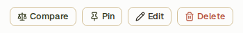
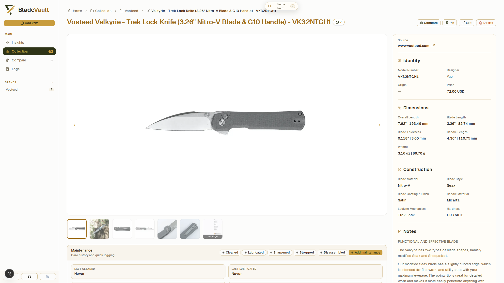
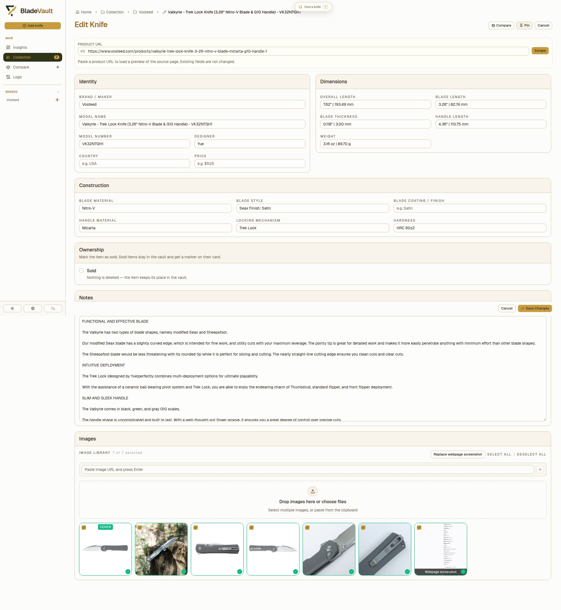
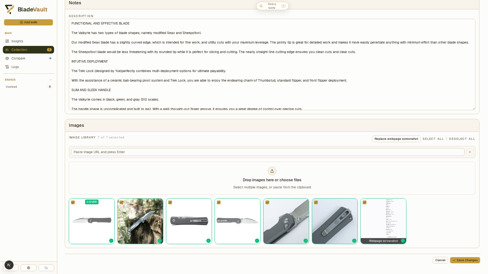
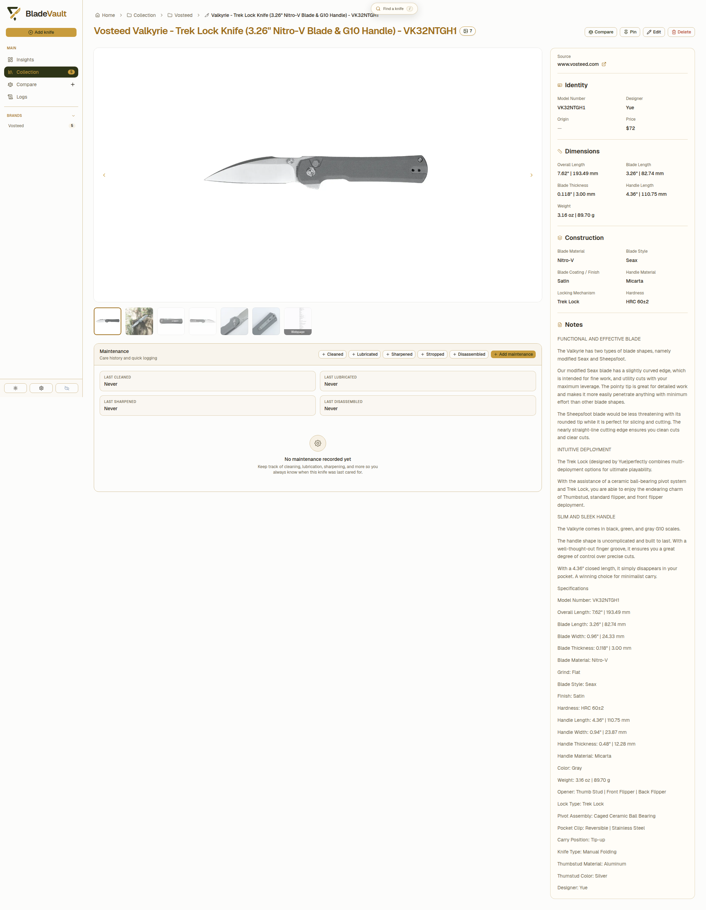

# Update a saved knife

An import is a starting point, not a finished record. It fills what the page states and leaves the rest blank, and occasionally a value lands in the wrong field. Everything stays editable afterwards: open the knife, click **Edit**, and change anything. The record below is the imported Vosteed Valkyrie (VK32NTGH1) being tidied up.

## 1. Open the record and click **Edit**

At the top right of the record, click **Edit**:

The record you land on is the read-only view — specifications, notes, images, and the link to the source page:

Clicking **Edit** swaps it for the **Edit Knife** view, which gives you the whole record at once:

- **Product URL** — the page the knife was imported from, kept on the record so you can see where a value came from.
- **Identity, Dimensions, Construction, Notes** — every field, prefilled with what was imported.
- **Images** — every picture that came with the import, with the webpage capture, where you tick which ones to keep, set the **cover**, reorder, or remove them.
- **Ownership** — mark the knife **Sold** when it leaves the collection; it stays in the vault with a marker on its card.

## 2. Correct what the import got wrong

The Valkyrie's page lists blade style and finish in one row, so the import wrote **Seax Finish: Satin** into **Blade style** and left **Blade Coating / Finish** empty. Splitting them — **Seax** and **Satin** — is two edits. The same pass fills what a product page rarely states, such as the price.

Nothing is overwritten in bulk and nothing is lost: change one field and the rest of the record stays as it was.

## 3. Save the changes

At the bottom right of the edit form, click **Save Changes**:

**Save Changes** writes the edits and returns you to the record.

## 4. See the corrected record

The **Source** link still points at the page it came from, so the next time you wonder where a specification came from, the answer is one click away — and if the import captured the page, that screenshot is in the gallery too (see [Capture source pages](capture-sources.md)).

## Related

- **Maintenance** — cleaning, lubrication, sharpening, stropping, and disassembly are logged from the same record, with dated notes.
- **Compare** — a knife can be added to several named shortlists; see [Compare knives](compare.md).
- **Bulk edits** — several records at once are handled from the collection; see [Organize your collection](collection.md).

## Next

- [Capture source pages](capture-sources.md) — the full-page screenshot behind an import.
- [Your data](../reference/data.md) — where the vault lives, and how to back it up.
